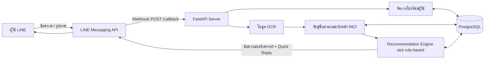
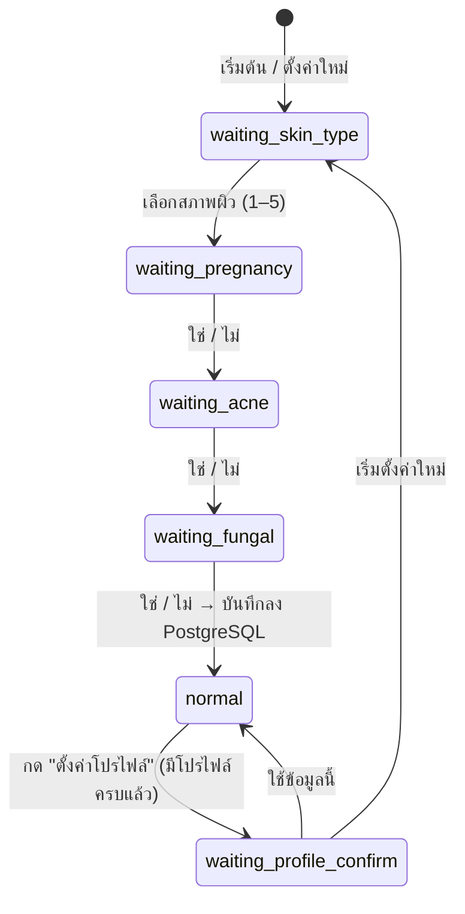

# บทที่ 3 วิธีการดำเนินงานวิจัย

> ระบบ **SkinSafe Bot** — ระบบวิเคราะห์ส่วนผสมเครื่องสำอางจากภาพฉลากผ่าน LINE Chatbot โดยใช้ฐานข้อมูลส่วนผสม (INCI)
>
> เอกสารนี้สรุปเฉพาะส่วนที่ใช้งานจริงในระบบปัจจุบัน อ้างอิงจากซอร์สโค้ดใน `SkinSafe_backend/app/` และไฟล์ข้อมูลใน `ingredient_merge_output/` และ `data/`
> (รายละเอียดของโมดูล OCR อธิบายแยกไว้อีกส่วน)

---

## 3.1 ภาพรวมของระบบ

ระบบทำงานผ่าน LINE Official Account ผู้ใช้ตั้งค่าโปรไฟล์ผิวก่อน แล้วถ่ายภาพฉลากส่วนผสม (Ingredients) ส่งเข้ามาในแชท โมดูล OCR จะแปลงภาพเป็นข้อความ จากนั้นระบบจับคู่ชื่อส่วนผสมกับฐานข้อมูล INCI วิเคราะห์ตามโปรไฟล์ของผู้ใช้ด้วยกฎ (rule-based) แล้วตอบกลับผลในแชท พร้อมบันทึกผลลง PostgreSQL

**องค์ประกอบหลักของระบบ**

| องค์ประกอบ | ไฟล์ | หน้าที่ |
|---|---|---|
| Webhook และ chatbot flow | `main_LINE_quickreply_profile_persistent.py` | รับ event จาก LINE, จัดการโปรไฟล์, เรียกโมดูลวิเคราะห์, ตอบกลับ |
| จับคู่ชื่อส่วนผสม | `ocr_paddle_fuzzy.py` (`correct_with_vocabulary`) | แปลงข้อความจาก OCR เป็นชื่อ INCI มาตรฐานในฐานข้อมูล |
| วิเคราะห์และแนะนำ | `recommendation.py` (`recommend`) | จำแนกสถานะส่วนผสมและสรุปผลตามโปรไฟล์ |
| ฐานข้อมูล | `db.py` | เชื่อมต่อและ query PostgreSQL |

---

## 3.2 เครื่องมือและเทคโนโลยีที่ใช้

| ประเภท | เครื่องมือ |
|---|---|
| ภาษา | Python |
| Web framework | FastAPI (endpoint `POST /callback`) |
| Chatbot platform | LINE Messaging API (`line-bot-sdk`): Quick Reply, Camera Action, Rich Menu |
| Fuzzy string matching | RapidFuzz (`fuzz.ratio`, `process.extractOne`) |
| ฐานข้อมูล | PostgreSQL ผ่าน `psycopg2` |
| การตั้งค่า | `python-dotenv` (`LINE_TOKEN`, `LINE_SECRET`, `DATABASE_URL`) |
| จัดการข้อมูล | pandas, ไฟล์ CSV และ SQL script |

---

## 3.3 การเตรียมฐานข้อมูลส่วนผสม (Ingredient Dataset)

### 3.3.1 แหล่งข้อมูล

| ชุดข้อมูล | จำนวน | รายละเอียด |
|---|---|---|
| `ingredient_master_dataset_fixed.csv` (Master) | 11,091 รายการ | ชื่อ INCI, เลข CAS, หน้าที่ (function), ชื่อสาร |
| `common_ingredients_patch.csv` (Patch) | 199 รายการ | ส่วนผสมที่พบบ่อยบนฉลากจริงแต่ไม่มีใน Master เช่น Glycerin, Niacinamide, Aqua, Fragrance คัดเฉพาะชื่อที่พบบนฉลากผลิตภัณฑ์ตั้งแต่ 5 ฉลากขึ้นไป |

ผู้วิจัยเพิ่มเฉพาะชื่อที่พบบ่อยใน Patch ไม่ได้ใส่ชื่อที่หายากทั้งหมด เพราะจากการทดลอง การเพิ่มชื่อที่หายากทำให้มีชื่อที่ใกล้เคียงกันมากขึ้น และทำให้การจับคู่ชื่อผิดบ่อยขึ้น

### 3.3.2 ขั้นตอนการรวมและตรวจสอบความถูกต้องของข้อมูล (Identity Resolution)

1. **รวมชุดข้อมูล (Union):** Master + Patch = 11,290 แถว
2. **หาคู่ที่อาจเป็นสารเดียวกัน:**
   - ชื่อ INCI ตรงกันหลัง normalize: 0 คู่
   - เลข CAS เดียวกันแต่ชื่อ INCI ต่างกัน: 9 คู่
   - ชื่อคล้ายกันด้วย fuzzy score ≥ 90: 47 คู่
3. **ตรวจสอบด้วยมือ (Manual review)** ทั้ง 56 คู่ โดยเทียบกับแหล่งอ้างอิง เช่น CosIng และ PubChem
   - ตัดสินว่าเป็นสารเดียวกัน (SAME): 4 คู่ → รวมเป็นรายการเดียว
   - ตัดสินว่าเป็นคนละสาร (DIFFERENT): 52 คู่ → แยกไว้เหมือนเดิม
4. **หลักการ:** ไม่ใช้คะแนน fuzzy เป็นหลักฐานยืนยันว่าเป็นสารเดียวกัน และไม่ใช้เลข CAS เป็น key แบบหนึ่งต่อหนึ่ง
5. **ผลลัพธ์:** ได้ส่วนผสมมาตรฐาน (canonical) **11,286 รายการ** ไม่มีชื่อซ้ำ

### 3.3.3 การจัดขอบเขตผลิตภัณฑ์ (Product Scope Classification)

ผู้วิจัยจัดหมวดส่วนผสมแต่ละรายการตามความเกี่ยวข้องกับผลิตภัณฑ์ดูแลผิวหน้า

| product_scope | จำนวน |
|---|---|
| FACIAL_SKINCARE | 11,109 |
| BOTH | 47 |
| FACIAL_SUNSCREEN | 24 |
| REVIEW (รอตรวจสอบ) | 89 |
| EXCLUDE | 17 |

> คอลัมน์ product_scope และคอลัมน์ audit/evidence ใช้ในขั้นเตรียมข้อมูลเท่านั้น ไม่ได้นำเข้าตาราง `ingredients` (เก็บไว้ใน `86_final_master_with_deterministic_ids.csv`)

### 3.3.4 การทำความสะอาดข้อมูล

- แปลงชื่อ INCI ที่ถูกเก็บในรูป tuple (เช่น `('GLYCERIN',)`) ให้เป็นข้อความปกติ ตรวจแล้วครบทั้ง 11,286 แถว ไม่มีค่าว่างและไม่มีชื่อซ้ำ
- แยกหน้าที่ของส่วนผสม (function) ออกเป็นตารางของตัวเอง ได้ **66 functions** เช่น emollient, humectant, preservative, surfactant, uv-filter, skin-conditioning
- สร้างความสัมพันธ์ระหว่างส่วนผสมกับหน้าที่ **19,475 คู่**

### 3.3.5 การนำเข้าและตรวจสอบฐานข้อมูล

นำเข้าด้วย `87_skin_safe_postgresql_import.sql` และตรวจสอบด้วย `89_skin_safe_pgadmin_validation.sql`

| รายการตรวจสอบ | ผล |
|---|---|
| จำนวน ingredients / functions / ingredient_functions | 11,286 / 66 / 19,475 ตรงตามที่คาด |
| ชื่อส่วนผสมซ้ำ | 0 |
| คู่ ingredient–function ซ้ำ | 0 |
| ID ที่อ้างถึงแต่ไม่มีอยู่จริง (orphan) | 0 |
| ส่วนผสมที่ไม่มี function | 4 รายการ (FRAGRANCE, DEIONIZED WATER, PERFUME, PARFUM (FRAGRANCE)) |

### 3.3.6 ข้อมูลความเสี่ยงตามโปรไฟล์ (Profile-specific Risk Data)

ผู้วิจัยเพิ่มข้อมูลความเสี่ยงลงตาราง `ingredient_risks` ด้วยตนเอง (ส่วน pregnancy, comedogenic และ fungal_acne_trigger เพิ่มด้วย `seed_profile_risks.sql`) โดยค่า `risk_type` ต้องตรงกับเงื่อนไขใน `recommendation.py` ปัจจุบันมีทั้งหมด **22 รายการ**

| risk_type | ใช้กับผู้ใช้กลุ่ม | ส่วนผสม | risk_level | evidence_level |
|---|---|---|---|---|
| `pregnancy` (6) | ตั้งครรภ์ | Retinol, Retinyl Palmitate, Retinyl Acetate, Retinal, Hydroxypinacolone Retinoate (high); Salicylic Acid (low) | high / low | MEDIUM |
| `comedogenic` (4) | เป็นสิวง่าย | Isopropyl Myristate, Isopropyl Isostearate, Myristyl Myristate, Isocetyl Stearate | high | LOW |
| `fungal_acne_trigger` (8) | สิวเชื้อรา (Malassezia) | Olive Fruit Oil, Oleic Acid, Polysorbate 20/80, Sorbitan Oleate (moderate); Glyceryl Stearate, Palmitic Acid, Stearic Acid (low) | moderate / low | LOW |
| `skin_sensitization` (4) | ผิวแพ้ง่าย | Limonene, Benzyl Alcohol (HIGH); Octyldodecanol, Rosmarinus Officinalis Leaf Extract (MEDIUM) | moderate | HIGH / MEDIUM |

ผู้วิจัยเขียนคำอธิบาย (note) ของแต่ละรายการตามหลักฐานทางวิชาการ เช่น อนุพันธ์วิตามินเอ (retinoid) ควรหลีกเลี่ยงระหว่างตั้งครรภ์, ค่า comedogenicity จากการทดสอบ rabbit-ear, กรดไขมันสาย C12–C24 ที่เชื้อ Malassezia ใช้เจริญเติบโตได้ และผลการทดสอบภูมิแพ้ทางผิวหนัง (patch test) ของสารที่ทำให้แพ้ (ที่มาของ evidence_level อธิบายในหัวข้อ 3.7.3)

### 3.3.7 ข้อมูลความเหมาะสมกับประเภทผิวและหลักฐานอ้างอิง

- **`ingredient_skin_effects`:** ผู้วิจัยบันทึกด้วยมือจากคำแนะนำของ American Academy of Dermatology (AAD) ปัจจุบันครอบคลุม 4 ส่วนผสม ได้แก่ Glycerin, Hyaluronic Acid, Niacinamide และ Salicylic Acid (รายละเอียดในหัวข้อ 3.7.3)
- **`ingredient_evidence`:** ผู้วิจัยรวบรวมหลักฐาน **77 รายการ ครอบคลุม 22 ส่วนผสม** (ก่อนตรวจความซ้ำ ดูหัวข้อ 3.3.8) แต่ละรายการเก็บข้อความที่หลักฐานสนับสนุน (claim), ประเภทแหล่งข้อมูล, ชื่อแหล่งข้อมูล, การอ้างอิง (PMID / DOI), ปีที่เผยแพร่ และระดับหลักฐาน แหล่งข้อมูลที่ใช้ ได้แก่ PubMed, รายงาน safety assessment ของ Cosmetic Ingredient Review (CIR), AAD, DermNet, งานวิจัยทางคลินิก, randomized clinical trial, case report และบทความทบทวนวรรณกรรม

### 3.3.8 การตรวจความซ้ำของหลักฐานอ้างอิง (Evidence Deduplication)

หลักฐานอ้างอิงถูกรวบรวมจากหลายแหล่งและหลายรอบ บทความเดียวกันจึงอาจถูกบันทึกซ้ำได้ เช่น พบบทความเดียวกันทั้งจาก PubMed และจากหน้าเว็บของวารสาร หรือพบทั้งบทความต้นฉบับและประกาศแก้ไข (correction) ถ้าไม่ตรวจ จำนวนหลักฐานที่ระบบแสดงให้ผู้ใช้เห็นจะสูงเกินจริง ผู้วิจัยจึงตรวจความซ้ำตามขั้นตอนต่อไปนี้

1. **ขอบเขตการตรวจ:** ตรวจภายในส่วนผสมเดียวกัน (`ingredient_id` เดียวกัน) เท่านั้น ถ้าแหล่งอ้างอิงเดียวกันถูกใช้กับส่วนผสมต่างกัน เช่น systematic review ที่ศึกษาหลายสาร จะไม่นับเป็นข้อมูลซ้ำ เพราะเป็นหลักฐานของคนละส่วนผสม
2. **เทียบตัวระบุเอกสาร:** ดึง PMID, DOI และ URL จากข้อมูลการอ้างอิง ปรับให้อยู่ในรูปแบบเดียวกัน (normalize) แล้วจัดกลุ่มแถวที่มีตัวระบุตรงกัน
3. **ตรวจการศึกษาเดียวกันที่ใช้ตัวระบุต่างกัน:** ตรวจ metadata ของบทความ (ชื่อเรื่อง ผู้แต่ง วารสาร ปี) จากฐานข้อมูล PubMed ผ่าน NCBI E-utilities เพื่อหาเอกสารที่เป็นการศึกษาเดียวกันแต่มีเลขต่างกัน เช่น ประกาศแก้ไขที่มี PMID แยกจากบทความต้นฉบับ
4. **เทียบข้อความที่หลักฐานสนับสนุน (claim):** อ่าน claim ของแถวที่อยู่ในกลุ่มเดียวกันแล้วกำหนดสถานะ
   - `DUPLICATE`: แหล่งเดียวกันและ claim เดียวกัน
   - `NEEDS_REVIEW`: แหล่งเดียวกันแต่ claim ต่างกัน หรือแถวเดียวรวมหลายแหล่งไว้ด้วยกัน
   - `NEW_CANDIDATE`: หลักฐานใหม่ที่ไม่ซ้ำกับข้อมูลเดิม
   - `HOLD`: ข้อมูลขัดแย้งหรือยังตัดสินใจไม่ได้
5. **เลือกแถวที่เก็บไว้** ตามลำดับความสำคัญ
   - (1) แถวที่เชื่อมกับ Effect หรือ Risk อยู่แล้ว
   - (2) แถวที่ผ่านการตรวจสอบแล้ว (มีวันที่ตรวจ `reviewed_at`)
   - (3) แถวที่การอ้างอิงครบกว่า (ผู้แต่ง ชื่อเรื่อง DOI)
   - (4) แถวที่ claim ละเอียดกว่า

   ถ้าแถวที่จะนำออกมีข้อมูลที่แถวที่เก็บไว้ไม่มี (เช่น DOI หรือเลขทะเบียนการทดลองทางคลินิก) ให้ย้ายข้อมูลนั้นมาก่อน
6. **ตรวจความสัมพันธ์ก่อนแก้ไข:** ตาราง `effect_evidence` และ `risk_evidence` อ้างถึงแถวหลักฐานแบบ `ON DELETE CASCADE` ผู้วิจัยจึงตรวจก่อนว่าแถวที่จะนำออกไม่มีลิงก์กับ Effect หรือ Risk เพื่อไม่ให้ความสัมพันธ์หายไปโดยไม่ตั้งใจ
7. **ไม่ลบอัตโนมัติ:** ระบบไม่ลบหลักฐานเอง ผู้วิจัยพิจารณาและอนุมัติทีละกลุ่มก่อนแก้ไขฐานข้อมูล แล้วรันการตรวจซ้ำอีกครั้งเพื่อยืนยันว่าไม่เหลือข้อมูลซ้ำ

**ผลการตรวจรอบแรก** (หลักฐาน 77 แถว, 22 ส่วนผสม): พบกลุ่มที่ซ้ำหรือซ้อนกัน 10 กลุ่ม แบ่งเป็น `DUPLICATE` 8 กลุ่มและ `NEEDS_REVIEW` 3 รายการ (หนึ่งกลุ่มมีทั้งสองสถานะ) ในจำนวนนี้มี 1 กรณีที่ตรวจพบจากขั้นที่ 3 เท่านั้น คือประกาศแก้ไขที่มี PMID แยกจากบทความต้นฉบับ ซึ่งการเทียบตัวระบุอย่างเดียวจะตรวจไม่พบ รายละเอียดอยู่ในไฟล์ `data/90_evidence_duplicate_review.md` *(ผลหลังแก้ไขจะบันทึกเพิ่มเมื่อผู้วิจัยอนุมัติรายการแก้ไขแล้ว)*

---

## 3.4 การออกแบบฐานข้อมูล (PostgreSQL)

| ตาราง | คอลัมน์สำคัญ | หน้าที่ |
|---|---|---|
| `skin_types` | skin_type_id, skin_type_name | ประเภทผิว 5 แบบ |
| `ingredients` | ingredient_id, ingredient_name, cas_no, description | คลังชื่อ INCI มาตรฐาน (11,286 รายการ) |
| `functions` | function_id, function_name | หน้าที่ของส่วนผสม (66 รายการ) |
| `ingredient_functions` | ingredient_id, function_id | ความสัมพันธ์แบบ many-to-many |
| `ingredient_skin_effects` | effect_id, ingredient_id, skin_type_id, compatibility, severity, warning_reason | ความเหมาะสมของส่วนผสมกับแต่ละประเภทผิว |
| `ingredient_risks` | risk_id, ingredient_id, risk_type, risk_level, note, evidence_level | ข้อมูลความเสี่ยง |
| `ingredient_evidence` | evidence_id, ingredient_id, claim, source_type, source_name, citation, url_doi, publication_year, evidence_level, reviewed_at | หลักฐานอ้างอิงของส่วนผสม |
| `users` | line_user_id, skin_type_id, pregnancy_status, acne_prone, fungal_acne_prone | โปรไฟล์ผู้ใช้ (เก็บถาวร) |
| `scans` | scan_id, user_id, image_path, raw_ocr_text, cleaned_text | ประวัติการสแกนแต่ละครั้ง |
| `scan_results` | scan_id, detected_text, matched_ingredient_id, confidence_score | ส่วนผสมที่ตรวจพบในแต่ละการสแกน |
| `recommendations` | scan_id, overall_result, warning_message, suitable, safe_score | ผลการวิเคราะห์ของแต่ละการสแกน |

**รหัสประเภทผิว (skin_type_id) ที่ใช้ในระบบ:** 1 = ผิวแห้ง, 2 = ผิวมัน, 3 = ผิวผสม, 4 = ผิวแพ้ง่าย (Sensitive), 5 = ผิวปกติ

---

## 3.5 การรับข้อมูลโปรไฟล์ผู้ใช้ผ่าน LINE

ระบบเก็บโปรไฟล์ถาวรในตาราง `users` ส่วนสถานะการสนทนา (state) ระหว่างกรอกข้อมูลเก็บไว้ในหน่วยความจำชั่วคราว ผู้ใช้ต้องกรอกให้ครบ **4 รายการ** ก่อนจึงจะสแกนได้

1. **สภาพผิว:** ผิวปกติ / ผิวแห้ง / ผิวมัน / ผิวผสม / ผิวแพ้ง่าย
2. **ตั้งครรภ์หรือไม่:** ใช่ / ไม่
3. **มีปัญหาสิวหรือไม่:** ใช่ / ไม่
4. **มีปัญหาสิวเชื้อรา (Fungal acne) หรือไม่:** ใช่ / ไม่

**การออกแบบที่สำคัญ**
- ใช้ **Quick Reply** ให้ผู้ใช้กดตอบ เพื่อลดการพิมพ์ผิด
- ใช้ **Rich Menu** สำหรับเมนู "ตั้งค่าโปรไฟล์", "วิธีใช้งาน" และ "เกี่ยวกับระบบ"
- เมื่อผู้ใช้เพิ่มเพื่อน (Follow Event) ระบบตรวจว่ามีโปรไฟล์เดิมหรือไม่ แล้วแสดงข้อความต้อนรับตามกรณี
- หลังบันทึก ระบบอ่านข้อมูลกลับจาก DB อีกครั้งเพื่อยืนยันว่าบันทึกสำเร็จจริง
- ทุกครั้งที่ได้รับรูปภาพ ระบบโหลดโปรไฟล์ล่าสุดจาก PostgreSQL ก่อนวิเคราะห์ จึงไม่พึ่งข้อมูลในหน่วยความจำ ทำให้ข้อมูลไม่หายเมื่อเซิร์ฟเวอร์รีสตาร์ท
- ถ้าโปรไฟล์ยังไม่ครบ ระบบจะไม่วิเคราะห์ภาพ และให้ผู้ใช้ไปตั้งค่าโปรไฟล์ก่อน

---

## 3.6 การจับคู่ชื่อส่วนผสมกับฐานข้อมูล (Ingredient Matching)

ข้อความที่ได้จากโมดูล OCR มักมีคำขาด คำติดกัน หรือเครื่องหมายผิด ระบบจึงแปลงข้อความให้เป็นชื่อ INCI มาตรฐาน โดยใช้คลังคำ (vocabulary) ที่โหลดจากตาราง `ingredients` ตอนเริ่มเซิร์ฟเวอร์ (`correct_with_vocabulary`)

**ขั้นตอน**

1. **รวมบรรทัด:** นำข้อความทุกบรรทัดจาก OCR มาต่อกันเป็นข้อความเดียวก่อนแยกชื่อ เพราะบนฉลากชื่อส่วนผสมยาว ๆ มักถูกตัดขึ้นบรรทัดใหม่ (เช่น "Hydrogenated" / "Lecithin") ถ้าแก้ทีละบรรทัด ชื่อจะขาดเป็นสองท่อนและจับคู่ไม่ได้
2. **ตัดหัวข้อฉลาก:** ลบข้อความส่วนหัวที่มีคำว่า "ingredient" ตามด้วย `:` ออก (เช่น "Ingredients:")
3. **แยกชื่อส่วนผสม (Tokenization):**
   - แยกด้วยจุลภาค ยกเว้นจุลภาคที่ตามด้วยตัวเลข เพื่อไม่ให้ชื่ออย่าง "1,2-Hexanediol" ถูกแยก
   - แยกด้วยเครื่องหมาย `:` (รวมแบบ full-width `：`) ด้วย เผื่อกรณีที่ OCR อ่านคำว่า "Ingredients" เพี้ยนจนขั้นตอนที่ 2 ตัดไม่ออก เศษหัวข้อจะได้ไม่ติดไปกับชื่อส่วนผสมแรก
   - ตัดอักขระ ` . ; : * -` ที่หัวและท้ายของแต่ละชื่อ
4. **จับคู่แต่ละชื่อกับคลังคำ:** ใช้ RapidFuzz `process.extractOne` กับ `fuzz.ratio` หาชื่อที่ใกล้ที่สุด โดยแปลงเป็นตัวพิมพ์เล็กก่อนเทียบ (ฉลากมักพิมพ์ตัวใหญ่ทั้งหมด แต่ชื่อในคลังเป็นตัวพิมพ์ปกติ)
5. **เกณฑ์รับผลการจับคู่**
   - คะแนนความคล้ายต้องได้ **≥ 85** ผู้วิจัยเลือกค่านี้จากการทดลองปรับค่า threshold ช่วง 75–95 แล้ววัดผลด้วย Set F1 ค่า 85 ให้ผลดีกว่า 90 และถ้าต่ำกว่าประมาณ 82 ชื่อที่ถูกต้องอยู่แล้วจะถูกแก้เป็นชื่ออื่นที่ใกล้เคียงผิดบ่อยขึ้น
   - ความยาวของข้อความกับชื่อที่จับคู่ต้องต่างกันไม่เกิน **1.6 เท่า** เพื่อป้องกันการจับคู่ข้อความสั้นหรือข้อความที่ขาดเข้ากับชื่อที่ยาวกว่ามาก (หรือสั้นกว่ามาก) ซึ่งไม่เกี่ยวข้องกัน
   - ข้อความที่สั้นกว่า **3 ตัวอักษร** ไม่นำไปจับคู่
6. **แยกชื่อที่ติดกัน (Glued-name splitting):** ถ้าจับคู่ทั้งข้อความไม่ได้ ระบบจะลองแบ่งข้อความเป็นสองส่วนตรงช่องว่างทุกตำแหน่ง (เช่น "DIMETHICONE NIACINAMIDE" ที่ OCR อ่านจุลภาคหาย) และเลือกตำแหน่งที่ทั้งสองส่วนจับคู่ผ่านเกณฑ์ในข้อ 5 โดยได้คะแนนรวมสูงสุด
7. **ผลลัพธ์:** ได้รายชื่อที่คั่นด้วยจุลภาค ข้อความที่จับคู่ไม่ได้จะคงข้อความเดิมไว้ ไม่ถูกเดาเป็นชื่ออื่น เมื่อส่งต่อไปยังระบบวิเคราะห์ (หัวข้อ 3.7) ชื่อที่ไม่พบในฐานข้อมูลจะถูกรายงานเป็น **unmatched** ให้ผู้ใช้เห็น และระบบตัดชื่อซ้ำในขั้นตอนวิเคราะห์

---

## 3.7 ระบบวิเคราะห์และแนะนำ (Rule-based Recommendation Engine)

ระบบประเมินโดยใช้ข้อมูลที่มีอยู่ในฐานข้อมูลเท่านั้น (`recommendation.py`) ไม่ได้ใช้โมเดลเรียนรู้ของเครื่อง

### 3.7.1 แปลงโปรไฟล์ผู้ใช้เป็นเงื่อนไข

| เงื่อนไขในโปรไฟล์ | risk_type ที่ใช้ตรวจ |
|---|---|
| ตั้งครรภ์ (`pregnancy_status = true`) | `pregnancy` |
| เป็นสิวง่าย (`acne_prone = true`) | `comedogenic`, `acne_trigger` |
| สิวเชื้อรา (`fungal_acne_prone = true`) | `fungal_acne_trigger` |
| ผิวแพ้ง่าย (`skin_type_id = 4`) | `skin_sensitization`, `irritation` |

### 3.7.2 ดึงข้อมูลของแต่ละส่วนผสม

สำหรับส่วนผสมแต่ละรายการ (ตัดชื่อซ้ำแล้ว) ระบบดึงข้อมูลดังนี้
- `ingredients`: หาส่วนผสมจากชื่อ (ไม่สนตัวพิมพ์ใหญ่–เล็ก) ถ้าไม่พบจะถือเป็น **unmatched**
- `ingredient_skin_effects`: ความเหมาะสม (compatibility) กับประเภทผิวของผู้ใช้
- `ingredient_risks`: ข้อมูลความเสี่ยง
- `ingredient_evidence`: หลักฐานอ้างอิง

### 3.7.3 ข้อมูลที่ใช้เป็นเกณฑ์จำแนก

ระบบจำแนกสถานะของส่วนผสมจากข้อมูล 3 ชั้น ซึ่งเก็บแยกตารางกัน เพราะแต่ละชั้นตอบคำถามคนละข้อ

| ชั้นข้อมูล | ตาราง | คำถามที่ตอบ | ค่าที่ใช้ |
|---|---|---|---|
| 1. ความเหมาะสมกับประเภทผิว | `ingredient_skin_effects` | ส่วนผสมนี้มีแหล่งอ้างอิงระบุว่าเหมาะหรือควรระวังกับ**ประเภทผิวของผู้ใช้**หรือไม่ | `compatibility` = compatible / caution, `severity`, `warning_reason` |
| 2. ความเสี่ยง | `ingredient_risks` | ส่วนผสมนี้มีรายงานความเสี่ยงเฉพาะด้านหรือไม่ (เช่น ระหว่างตั้งครรภ์, อุดตัน, ก่อการแพ้) | `risk_type`, `risk_level`, `evidence_level`, `note` |
| 3. หลักฐานอ้างอิง | `ingredient_evidence` | มีเอกสารทางวิชาการเกี่ยวกับส่วนผสมนี้หรือไม่ | `claim`, `source_type`, `citation`, `evidence_level` |

**หลักการบันทึกข้อมูลทั้ง 3 ชั้น**
- ทุกรายการต้องมี**แหล่งอ้างอิงระบุไว้โดยตรง** ผู้วิจัยรวบรวมและบันทึกด้วยมือ (manual curation) จากแหล่งข้อมูลทางวิชาการและทางการแพทย์ เช่น คำแนะนำขององค์กรวิชาชีพแพทย์ผิวหนัง (American Academy of Dermatology: AAD), รายงาน safety assessment ของ Cosmetic Ingredient Review (CIR), ฐานข้อมูล PubMed และ DermNet
- **ไม่อนุมานจากหน้าที่ของสาร (function)** เช่น ไม่กำหนดว่าสารทุกตัวที่เป็น humectant เหมาะกับผิวแห้ง เพราะหน้าที่ของสารเพียงอย่างเดียวพิสูจน์ไม่ได้ว่าสารนั้นเหมาะหรือก่อการระคายเคืองกับผิวประเภทใด
- ถ้าไม่พบแหล่งอ้างอิง **จะไม่บันทึกข้อมูล** แทนที่จะเดาค่า

**ก) เกณฑ์กำหนดค่าความเหมาะสมกับประเภทผิว (compatibility)**

| ค่า | เกณฑ์ |
|---|---|
| `compatible` (severity = none) | แหล่งอ้างอิงแนะนำส่วนผสมนี้สำหรับประเภทผิวนั้นโดยตรง และไม่มีคำเตือน |
| `caution` (severity = low) | แหล่งอ้างอิงแนะนำหรือกล่าวถึงส่วนผสมนี้สำหรับประเภทผิวนั้น แต่ระบุข้อควรระวังไว้ด้วย เช่น อาจระคายเคืองในบางคน |
| ไม่บันทึก | ไม่พบแหล่งอ้างอิงที่ระบุความสัมพันธ์ระหว่างส่วนผสมกับประเภทผิวนั้น |

ข้อมูลนี้บันทึกแยกตามประเภทผิว ส่วนผสมเดียวกันจึงอาจเป็น compatible กับผิวประเภทหนึ่ง และไม่มีข้อมูลสำหรับผิวอีกประเภทหนึ่ง `warning_reason` ระบุไว้ด้วยว่า ข้อมูลแสดงความสัมพันธ์ตามหลักฐานกับประเภทผิวนั้นเท่านั้น ไม่ได้ยืนยันว่าเหมาะกับผู้ใช้ทุกคน

**หลักฐานรองรับเกณฑ์ compatibility**

| องค์ประกอบของเกณฑ์ | หลักฐานรองรับ |
|---|---|
| **ประเมินความเหมาะสมแยกตามประเภทผิว** | Baumann (2008) เสนอการจำแนกผิวตามลักษณะผิวมัน–แห้ง และผิวแพ้ง่าย–ทนทาน แล้วใช้ประเภทผิวเป็นเกณฑ์ในการเลือกผลิตภัณฑ์ทาผิว ส่วนนิยามของผิวแพ้ง่ายอ้างอิงตาม position paper ของ International Forum for the Study of Itch (Misery et al., 2017) ซึ่งนิยามว่าเป็นภาวะที่ผิวเกิดความรู้สึกไม่สบาย เช่น แสบ ร้อน คัน จากสิ่งกระตุ้นที่ปกติไม่ควรทำให้เกิดอาการ |
| **ใช้คำแนะนำขององค์กรวิชาชีพเป็นเกณฑ์หลักของค่า `compatible`** | AAD ซึ่งเป็นองค์กรวิชาชีพแพทย์ผิวหนัง จัดกลุ่มส่วนผสมตามประเภทผิวไว้โดยตรง เช่น หน้า "Do facial masks work, and should I add one to my skin care routine?" แบ่งรายการเป็น "ingredients for dry or sensitive skin" และ "ingredients for oily or acne-prone skin" (AAD, n.d.-a) ข้อมูลที่เผยแพร่ในรูปแบบนี้จึงเชื่อมส่วนผสมกับประเภทผิวได้โดยไม่ต้องอนุมานเอง |
| **ใช้ค่า `caution` เมื่อแหล่งอ้างอิงแนะนำแต่มีคำเตือน** | AAD แนะนำกรดบางชนิดสำหรับผิวมันเพราะช่วยลดความมัน แต่เตือนในหน้าเดียวกันว่าอาจแรงเกินไปสำหรับบางคน และควรหยุดหรือลดการใช้หากระคายเคือง (AAD, n.d.-b) และ AAD แนะนำให้ทดสอบผลิตภัณฑ์บนผิวบริเวณเล็ก ๆ ก่อนใช้ เพราะแม้ผลิตภัณฑ์ที่ระบุว่า "hypoallergenic" ก็อาจทำให้เกิดปฏิกิริยาได้ (AAD, n.d.-c) ระบบจึงแยกกรณีที่มีคำเตือนออกเป็น `caution` แทนที่จะรวมไว้กับ `compatible` |
| **ต้องมีหลักฐานโดยตรง และไม่อนุมานจากหน้าที่ของสาร** | Commission Regulation (EU) No 655/2013 ว่าด้วยเกณฑ์การกล่าวอ้างสรรพคุณเครื่องสำอาง กำหนดว่าการกล่าวอ้างทั้งแบบชัดแจ้งและโดยนัย "shall be supported by adequate and verifiable evidence" (Annex ข้อ 3(1)), ระดับหลักฐานต้องสอดคล้องกับประเภทของการกล่าวอ้าง (ข้อ 3(4)) และการประเมินต้องพิจารณาจากน้ำหนักของหลักฐานทั้งหมด (weight of evidence, ข้อ 3(7)) การบอกผู้ใช้ว่าส่วนผสม "เหมาะกับผิวของคุณ" ถือเป็นการกล่าวอ้างโดยนัย ผู้วิจัยจึงยึดหลักเดียวกัน การอนุมานจากหน้าที่ของสารในสูตรตำรับ (เช่น humectant) ไม่ใช่หลักฐานโดยตรงว่าสารนั้นเหมาะกับผิวประเภทใด จึงไม่นำมาใช้ |
| **ไม่บันทึกค่าเมื่อไม่มีหลักฐาน และไม่ถือว่าไม่มีข้อมูลเท่ากับปลอดภัย** | หลัก "absence of evidence is not evidence of absence" (Altman & Bland, 1995) ระบุว่าการไม่พบหลักฐานของผลกระทบไม่ได้พิสูจน์ว่าไม่มีผลกระทบ ส่วนผสมที่ไม่มีข้อมูลจึงได้สถานะ `no_evidence` แทนที่จะถูกจัดเป็น `compatible` |
| **จัดระดับความน่าเชื่อถือของหลักฐาน** (ใช้กับ evidence_level ในข้อ ค) | แนวคิดลำดับชั้นของหลักฐานตาม Oxford 2011 Levels of Evidence (OCEBM Levels of Evidence Working Group, 2011) ซึ่งจัดการทบทวนอย่างเป็นระบบและการศึกษาในมนุษย์ไว้ในระดับสูง และจัดเหตุผลเชิงกลไก (mechanism-based reasoning) ไว้ในระดับต่ำสุด |

**ข) เกณฑ์ของข้อมูลความเสี่ยง**

ประเภทความเสี่ยง (`risk_type`) แบ่งตามกลุ่มผู้ใช้ที่ได้รับผลกระทบ

| risk_type | ความหมาย |
|---|---|
| `pregnancy` | ส่วนผสมที่แหล่งอ้างอิงแนะนำให้หลีกเลี่ยงหรือระวังระหว่างตั้งครรภ์ |
| `comedogenic` / `acne_trigger` | ส่วนผสมที่อาจอุดตันรูขุมขนหรือกระตุ้นสิว |
| `fungal_acne_trigger` | ส่วนผสมที่เชื้อ Malassezia (สาเหตุของสิวเชื้อรา) อาจใช้เจริญเติบโตได้ |
| `skin_sensitization` / `irritation` | ส่วนผสมที่มีรายงานว่าทำให้เกิดการแพ้หรือระคายเคืองผิว |

ระดับความรุนแรง (`risk_level`) กำหนดตามคำแนะนำในแหล่งอ้างอิง

| risk_level | เกณฑ์ |
|---|---|
| `high` | แหล่งอ้างอิงแนะนำให้**หลีกเลี่ยง**ในผู้ใช้กลุ่มนั้น |
| `moderate` | มีหลักฐานว่าก่อปัญหาได้ในผู้ใช้บางคน ควรระวังหรือทดสอบก่อนใช้ |
| `low` | ข้อกังวลเกิดเฉพาะบางเงื่อนไข เช่น ความเข้มข้นสูงหรือใช้บนพื้นที่กว้าง หรือผลกระทบที่คาดว่าน้อย |

**ค) เกณฑ์ระดับหลักฐาน (evidence_level)**

ใช้เกณฑ์เดียวกันทั้งกับข้อมูลความเสี่ยงและข้อมูลหลักฐานอ้างอิง โดยพิจารณาจากประเภทและความแข็งแรงของหลักฐาน

| evidence_level | เกณฑ์ |
|---|---|
| HIGH | หลักฐานในมนุษย์ที่สอดคล้องกันหลายการศึกษา, รายงาน safety assessment ขององค์กรผู้เชี่ยวชาญ (เช่น CIR) หรือคำแนะนำขององค์กรวิชาชีพทางการแพทย์ (เช่น AAD) |
| MEDIUM | การศึกษาทางคลินิกจำนวนจำกัด, การศึกษาในสูตรผลิตภัณฑ์ที่มีส่วนผสมนั้น, รายงานผู้ป่วย (case report), บทความทบทวน หรือคำแนะนำแบบป้องกันไว้ก่อนที่อนุมานจากหลักฐานใกล้เคียง |
| LOW | หลักฐานจากสัตว์ทดลอง, การทดลองในห้องปฏิบัติการ (in vitro) หรืองานวิจัยที่เกี่ยวข้องกับส่วนผสมนั้นทางอ้อม |

ในระบบปัจจุบัน ระดับหลักฐานใช้บอกความน่าเชื่อถือของข้อมูลแต่ละรายการ ยังไม่ได้ใช้เปลี่ยนสถานะของส่วนผสม ส่วนการมีหรือไม่มีหลักฐานอ้างอิงใช้แยกสถานะ `evidence_only` ออกจาก `no_evidence`

### 3.7.4 เกณฑ์จำแนกสถานะรายส่วนผสม

**ที่มาของเกณฑ์:** ตารางตัดสินใจ (decision table) นี้**ผู้วิจัยออกแบบขึ้นเอง** ไม่ได้นำมาจากมาตรฐานใดโดยตรง ส่วน**ข้อมูล**ที่ใช้ตัดสินในแต่ละขั้นมีแหล่งอ้างอิงรองรับตามหัวข้อ 3.7.3

ระบบตรวจตามลำดับ และใช้เงื่อนไขแรกที่ตรง

| ลำดับ | เงื่อนไข | สถานะ | ความหมายที่แสดงต่อผู้ใช้ |
|---|---|---|---|
| 1 | compatibility = caution **และ** มี risk | `caution_with_risk` | 🟡 ควรใช้ด้วยความระมัดระวัง |
| 2 | compatibility = compatible **และ** มี risk | `compatible_with_risk` | 🟢 มีข้อมูลว่าเข้ากันได้ แต่มีข้อควรระวัง |
| 3 | มี risk (ไม่มีข้อมูล compatibility) | `risk_only` | 🔴 มีข้อควรระวัง |
| 4 | compatibility = caution | `caution` | 🟡 ควรใช้ด้วยความระมัดระวัง |
| 5 | compatibility = compatible | `compatible` | 🟢 เหมาะกับผิวตามข้อมูลในฐานข้อมูล |
| 6 | มีเฉพาะหลักฐานอ้างอิง | `evidence_only` | ⚪ มีข้อมูลประกอบ แต่ยังสรุปความเหมาะสมไม่ได้ |
| 7 | ไม่มีข้อมูลใดเลย | `no_evidence` | ⚪ ยังไม่มีข้อมูลเพียงพอ |

**เหตุผลของการออกแบบ**

1. **ความเสี่ยงมาก่อนความเหมาะสม (หลักป้องกันไว้ก่อน):** ถ้าส่วนผสมมีทั้งข้อมูลว่าเหมาะกับผิวและข้อมูลความเสี่ยง ระบบจะไม่ซ่อนความเสี่ยงไว้ภายใต้คำว่า "เหมาะ" จึงใช้สถานะผสม (`compatible_with_risk`, `caution_with_risk`) ให้ผู้ใช้เห็นทั้งสองด้าน
2. **caution มาก่อน compatible:** ถ้าส่วนผสมมีข้อมูลหลายรายการสำหรับประเภทผิวเดียวกัน และมีรายการใดเป็น caution ระบบจะใช้ caution
3. **มีหลักฐานไม่ได้แปลว่าเหมาะ:** การมีงานวิจัยเกี่ยวกับสารใดสารหนึ่งไม่ได้แปลว่าสารนั้นเหมาะกับผิวประเภทของผู้ใช้ ระบบจึงแยกสถานะ `evidence_only` ออกจาก `compatible`
4. **ไม่มีข้อมูลไม่ได้แปลว่าปลอดภัย:** ส่วนผสมที่ไม่มีข้อมูลใดเลยได้สถานะ `no_evidence` ระบบจะไม่สรุปว่าส่วนผสมนั้นปลอดภัย

**การแจ้งเตือนตามโปรไฟล์ (profile alert):** สถานะในตารางข้างบนนับข้อมูลความเสี่ยง**ทุกประเภท**ของส่วนผสม โดยไม่ได้กรองตามโปรไฟล์ผู้ใช้ ระบบจึงมีอีกชั้นหนึ่งคือ profile alert ถ้า risk_type ของส่วนผสมตรงกับเงื่อนไขในโปรไฟล์ (หัวข้อ 3.7.1) ระบบจะแสดงข้อความแจ้งเตือนแยกไว้ในหัวข้อ "ข้อควรระวังตามโปรไฟล์ของคุณ"

**ตัวอย่างการจำแนกตามรูปแบบข้อมูลที่พบ**

| compatibility กับผิวของผู้ใช้ | ความเสี่ยง | หลักฐานอ้างอิง | สถานะ |
|---|---|---|---|
| compatible | ไม่มี | มีหรือไม่มีก็ได้ | `compatible` |
| caution | มี | มีหรือไม่มีก็ได้ | `caution_with_risk` |
| ไม่มีข้อมูลสำหรับผิวประเภทนี้ (อาจมีข้อมูลของผิวประเภทอื่น) | ไม่มี | มี | `evidence_only` |
| ไม่มีข้อมูล | มี (ตรงกับเงื่อนไขในโปรไฟล์) | มีหรือไม่มีก็ได้ | `risk_only` + profile alert |
| ไม่มีข้อมูล | ไม่มี | ไม่มี | `no_evidence` |

### 3.7.5 สรุปผลภาพรวมของผลิตภัณฑ์ (overall_status)

ระบบสรุปผลภาพรวมจากสถานะของทุกส่วนผสม โดยเรียงลำดับความสำคัญจากบนลงล่าง

| ลำดับ | overall_status | เงื่อนไข |
|---|---|---|
| 1 | `risk` | มีส่วนผสมสถานะ `risk_only`, `compatible_with_risk` หรือ `caution_with_risk` อย่างน้อย 1 รายการ **หรือ** มี profile alert อย่างน้อย 1 รายการ |
| 2 | `caution` | มีส่วนผสมสถานะ `caution` อย่างน้อย 1 รายการ |
| 3 | `no_evidence` | ทุกส่วนผสมเป็น `no_evidence` หรือ `evidence_only` **หรือ** เข้าเงื่อนไข `no_risk_found` แต่ยังมีส่วนผสมที่จับคู่กับฐานข้อมูลไม่ได้ |
| 4 | `no_risk_found` | กรณีอื่นนอกจากข้างบน |

เหตุผลที่จัดลำดับแบบนี้: ส่วนผสมที่มีความเสี่ยงเพียงรายการเดียวก็ทำให้ทั้งผลิตภัณฑ์ได้สถานะ `risk` เพราะผู้ใช้ใช้ผลิตภัณฑ์ทั้งขวด ไม่ได้เลือกใช้เฉพาะบางส่วนผสม และระบบจะไม่สรุปว่า "ไม่พบความเสี่ยง" ถ้ายังมีส่วนผสมที่ระบบไม่รู้จัก

**หลักการด้านความปลอดภัยของคำแนะนำ**
- **Uncovered conditions:** ถ้าผู้ใช้มีเงื่อนไขที่ฐานข้อมูลยังไม่มี risk_type ประเภทนั้นเลย ระบบจะแจ้งว่ายังยืนยันความปลอดภัยไม่ได้ และแนะนำให้ปรึกษาแพทย์หรือเภสัชกร
- `suitable = true` ก็ต่อเมื่อผลเป็น `no_risk_found` ไม่มีส่วนผสมที่จับคู่ไม่ได้ และไม่มี uncovered condition
- **ไม่คำนวณคะแนนความปลอดภัย** (`safe_score = NULL`) เพราะยังไม่มีวิธีให้คะแนนที่ผ่านการตรวจสอบความถูกต้อง
- ทุกข้อความตอบกลับมีหมายเหตุว่า ผลเป็นการประเมินจากข้อมูลในฐานข้อมูล ไม่ใช่การวินิจฉัยหรือคำแนะนำทางการแพทย์

### 3.7.6 รูปแบบข้อความตอบกลับ

ข้อความตอบกลับประกอบด้วย
- ประเภทผิวและเงื่อนไขที่นำมาพิจารณา
- สถานะภาพรวม
- ข้อควรระวังตามโปรไฟล์
- สถานะของแต่ละส่วนผสม พร้อมจำนวนหลักฐานและจำนวนความเสี่ยง
- รายการที่จับคู่ไม่ได้
- เงื่อนไขที่ฐานข้อมูลยังไม่ครอบคลุม

ท้ายข้อความมีปุ่ม Quick Reply "📸 สแกนขวดอื่นต่อ" และ "⚙️ ตั้งค่าโปรไฟล์"

---

## 3.8 การบันทึกผลการสแกน

หลังวิเคราะห์ ระบบบันทึกข้อมูลลง PostgreSQL ดังนี้
1. `scans`: ข้อความดิบจาก OCR (`raw_ocr_text`) และข้อความหลังจับคู่ชื่อแล้ว (`cleaned_text`)
2. `scan_results`: ส่วนผสมแต่ละรายการที่จับคู่กับ `ingredient_id` ได้
3. `recommendations`: ผลภาพรวม (`overall_result`), ข้อความตอบกลับ, `suitable` และ `safe_score` โดยใช้ report ชุดเดียวกับที่ตอบผู้ใช้

ถ้าการบันทึกล้มเหลว ระบบยังส่งผลวิเคราะห์ให้ผู้ใช้ได้ตามปกติ

---

## 3.9 การทดสอบระบบ

- **`test_e2e_db_write.py`:** ทดสอบแบบ end-to-end ตั้งแต่สร้างผู้ใช้ชั่วคราว บันทึกโปรไฟล์ วิเคราะห์ส่วนผสมตัวอย่าง (Niacinamide, Salicylic Acid, Limonene) บันทึก scan / scan_results / recommendation ตรวจข้อมูลที่บันทึก แล้วลบข้อมูลทดสอบทิ้ง
- **`89_skin_safe_pgadmin_validation.sql`:** ตรวจความถูกต้องของข้อมูลหลังนำเข้า (ดูหัวข้อ 3.3.5)

---

## 3.10 ข้อจำกัดของระบบ (ที่ทราบในปัจจุบัน)

- ผลวิเคราะห์ขึ้นกับความครอบคลุมของข้อมูลใน `ingredient_skin_effects`, `ingredient_risks` และ `ingredient_evidence` ส่วนผสมที่ไม่มีข้อมูลจะได้สถานะ `no_evidence` ระบบจะไม่สรุปว่าส่วนผสมนั้นปลอดภัย
- ข้อมูลที่ใช้จำแนกสถานะยังครอบคลุมส่วนผสมจำนวนน้อยเมื่อเทียบกับคลัง 11,286 รายการ ได้แก่ ความเหมาะสมกับประเภทผิว 4 ส่วนผสม, ความเสี่ยง 22 รายการ และหลักฐานอ้างอิง 22 ส่วนผสม ส่วนผสมส่วนใหญ่จึงได้สถานะ `no_evidence`
- evidence_level ของข้อมูลความเสี่ยงส่วนใหญ่อยู่ในระดับ LOW–MEDIUM
- สถานะรายส่วนผสมนับข้อมูลความเสี่ยงทุกประเภท โดยไม่กรองตามโปรไฟล์ เช่น ผู้ใช้ที่ไม่ได้ตั้งครรภ์จะยังเห็นส่วนผสมที่มีข้อมูลความเสี่ยงด้าน pregnancy เป็นสถานะที่มีความเสี่ยง ส่วนการแจ้งเตือนเฉพาะโปรไฟล์อยู่ใน profile alert
- เกณฑ์การจำแนกสถานะเป็นกฎที่ผู้วิจัยออกแบบเอง ยังไม่ได้ทดสอบความถูกต้องเทียบกับการประเมินของผู้เชี่ยวชาญ (แพทย์ผิวหนังหรือเภสัชกร)

---

## เอกสารอ้างอิงของบทที่ 3 (APA 7th)

Altman, D. G., & Bland, J. M. (1995). Absence of evidence is not evidence of absence. *BMJ, 311*(7003), 485. https://doi.org/10.1136/bmj.311.7003.485

American Academy of Dermatology. (n.d.-a). *Do facial masks work, and should I add one to my skin care routine?* Retrieved October 19, 2026, from https://www.aad.org/public/everyday-care/skin-care-secrets/routine/facial-masks-and-skin-care

American Academy of Dermatology. (n.d.-b). *How to control oily skin.* Retrieved October 19, 2026, from https://www.aad.org/public/everyday-care/skin-care-basics/dry/oily-skin

American Academy of Dermatology. (n.d.-c). *How to test skin care products before use.* Retrieved October 19, 2026, from https://www.aad.org/news/how-to-test-skin-care-products-before-use

Baumann, L. (2008). Understanding and treating various skin types: The Baumann Skin Type Indicator. *Dermatologic Clinics, 26*(3), 359–373. https://doi.org/10.1016/j.det.2008.03.007

European Commission. (2013). Commission Regulation (EU) No 655/2013 of 10 July 2013 laying down common criteria for the justification of claims used in relation to cosmetic products. *Official Journal of the European Union, L 190*, 31–34.

Misery, L., Ständer, S., Szepietowski, J. C., Reich, A., Wallengren, J., Evers, A. W. M., Takamori, K., Brenaut, E., Le Gall-Ianotto, C., Fluhr, J., Berardesca, E., & Weisshaar, E. (2017). Definition of sensitive skin: An expert position paper from the Special Interest Group on Sensitive Skin of the International Forum for the Study of Itch. *Acta Dermato-Venereologica, 97*(1), 4–6. https://doi.org/10.2340/00015555-2397

OCEBM Levels of Evidence Working Group. (2011). *The Oxford 2011 levels of evidence.* Oxford Centre for Evidence-Based Medicine. https://www.cebm.ox.ac.uk/resources/levels-of-evidence/ocebm-levels-of-evidence
- ระบบรองรับเฉพาะฉลากส่วนผสมภาษาอังกฤษ (INCI)
- ค่า `confidence_score` ใน `scan_results` บันทึกเป็น 1.0 ทุกรายการ เพราะระบบส่งเฉพาะรายการที่ผ่านเกณฑ์จับคู่แล้ว ยังไม่ได้เก็บคะแนน fuzzy จริงของแต่ละรายการ
