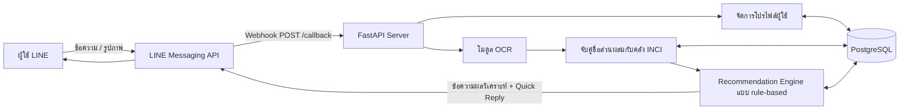
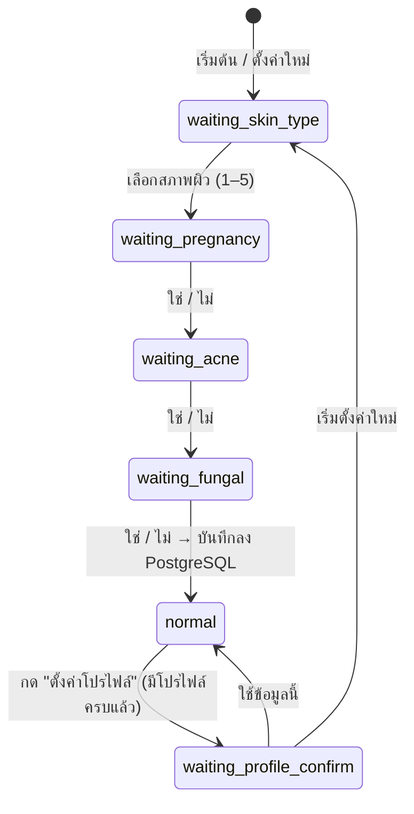

# บทที่ 3 วิธีการดำเนินงานวิจัย

> ระบบ **SkinSafe Bot** — ระบบวิเคราะห์ส่วนผสมเครื่องสำอางจากภาพฉลากผ่าน LINE Chatbot โดยใช้ฐานข้อมูลส่วนผสม (INCI)
>
> เอกสารนี้สรุปเฉพาะส่วนที่ใช้งานจริงในระบบปัจจุบัน อ้างอิงจากซอร์สโค้ดใน `SkinSafe_backend/app/` ไฟล์ข้อมูลใน `ingredient_merge_output/` และ `data/` และฐานข้อมูล PostgreSQL `skinsafe` (ตรวจ schema และจำนวนข้อมูลจริงเมื่อ 2026-10-20)
> (รายละเอียดของโมดูล OCR อยู่ในไฟล์ `CHAPTER3_METHODOLOGY.md`)
>
> ฉบับนี้รวมเนื้อหาจาก `ฉบับรอง.md` เข้ากับผลการทบทวนหลักฐานรายส่วนผสมรอบที่ 1 (หัวข้อ 3.3.9) รายการที่แก้จากฉบับเดิมอยู่ใน "บันทึกการแก้ไข" ท้ายไฟล์
> ข้อความในวงเล็บเหลี่ยม `[...]` คือข้อมูลที่ผู้วิจัยต้องตรวจสอบหรือเติมเอง

---

## 3.1 ภาพรวมของระบบ

ระบบทำงานผ่าน LINE Official Account ผู้ใช้ตั้งค่าโปรไฟล์ผิวก่อน แล้วถ่ายภาพฉลากส่วนผสม (Ingredients) ส่งเข้ามาในแชท โมดูล OCR จะแปลงภาพเป็นข้อความ จากนั้นระบบจับคู่ชื่อส่วนผสมกับฐานข้อมูล INCI วิเคราะห์ตามโปรไฟล์ของผู้ใช้ด้วยกฎ (rule-based) แล้วตอบกลับผลในแชท พร้อมบันทึกผลลง PostgreSQL



**องค์ประกอบหลักของระบบ**

| องค์ประกอบ | ไฟล์ | หน้าที่ |
|---|---|---|
| Webhook และ chatbot flow | `main_LINE_quickreply_profile_persistent.py` | รับ event จาก LINE, จัดการโปรไฟล์, เรียกโมดูลวิเคราะห์, ตอบกลับ |
| อ่านข้อความจากภาพ (OCR) | `ocr_core.py` (`run_ocr_lines`, `load_inci_vocabulary`) | เพิ่มขอบภาพ อ่านข้อความด้วย PaddleOCR และโหลดคลังคำ INCI |
| จับคู่ชื่อส่วนผสม | `ocr_paddle_fuzzy.py` (`correct_with_vocabulary`) | แก้ชื่อที่ OCR อ่านผิดให้เป็นชื่อในคลังคำ INCI |
| วิเคราะห์และแนะนำ | `recommendation.py` (`recommend`) | จำแนกสถานะส่วนผสมและสรุปผลตามโปรไฟล์ |
| ฐานข้อมูล | `db.py` | เชื่อมต่อและ query PostgreSQL |

---

## 3.2 เครื่องมือและเทคโนโลยีที่ใช้

| ประเภท | เครื่องมือ |
|---|---|
| ภาษา | Python 3.11.9 |
| Web framework | FastAPI (endpoint `POST /callback`) |
| Chatbot platform | LINE Messaging API (`line-bot-sdk`): Quick Reply, Camera Action, Rich Menu |
| OCR | PaddleOCR 3.7.0 (PP-OCRv6_medium) — รายละเอียดใน `CHAPTER3_METHODOLOGY.md` หัวข้อ 3.4 และ 3.12 |
| Fuzzy string matching | RapidFuzz 3.14.5 (`fuzz.ratio`, `process.extractOne`) |
| ฐานข้อมูล | PostgreSQL 18.6 ผ่าน `psycopg2` |
| การตั้งค่า | `python-dotenv` (`LINE_TOKEN`, `LINE_SECRET`, `DATABASE_URL`) |
| จัดการข้อมูล | pandas, ไฟล์ CSV และ SQL script |
| ตรวจสอบข้อมูลบทความวิชาการ | NCBI E-utilities (`esearch`, `esummary`, `efetch`) ของฐานข้อมูล PubMed |

---

## 3.3 การเตรียมฐานข้อมูลส่วนผสม (Ingredient Dataset)

### 3.3.1 แหล่งข้อมูล

ระบบใช้ข้อมูลชื่อสาร 2 ชุด ซึ่งทำหน้าที่ต่างกัน

| ข้อมูล | หน้าที่ | จำนวน |
|---|---|---|
| **คลังคำ INCI** (ไฟล์ CSV) = `ingredient_master_dataset_fixed.csv` + `vocabulary_patch_dev.csv` | ใช้แก้ชื่อที่ OCR อ่านผิด (หัวข้อ 3.6) เป็นชุดเดียวกับที่ใช้ประเมินผลใน `CHAPTER3_METHODOLOGY.md` | 11,091 + 399 = 11,490 ชื่อ |
| **ตาราง `ingredients`** (PostgreSQL) | ให้ `ingredient_id` แก่ชื่อที่จับคู่ได้ เพื่อเชื่อมกับข้อมูลความเหมาะสม ความเสี่ยง และหลักฐาน (หัวข้อ 3.7) | 11,519 รายการ |

ที่มา เกณฑ์ และความครอบคลุมของคลังคำ INCI อธิบายไว้ใน `CHAPTER3_METHODOLOGY.md` หัวข้อ 3.6 สรุปคือ ไฟล์หลัก (Master) รวบรวมจาก Open Beauty Facts, CosIng, PubChem และ Kaggle แต่ขาดชื่อที่พบบ่อยบนฉลากจำนวนมาก จึงเสริมด้วย `vocabulary_patch_dev.csv` ซึ่งสร้างจากข้อความเฉลยของชุด Dev 40 ผลิตภัณฑ์ (k = 1)

**การสร้างตาราง `ingredients`**
1. รวม Master กับคำศัพท์เสริมรุ่นแรก (`common_ingredients_patch.csv`, 199 ชื่อ) แล้วตรวจชื่อที่อาจเป็นสารเดียวกัน (หัวข้อ 3.3.2) ได้ 11,286 รายการ
2. เพิ่มชื่อใน `vocabulary_patch_dev.csv` ที่ยังไม่มีในตาราง 233 ชื่อ (2026-10-20) โดยใช้การสะกดตามไฟล์ แต่ละแถวระบุที่มาไว้ในคอลัมน์ `description` (SQL: `data/vocab_patch_to_ingredients_dryrun.sql`) ได้ 11,519 รายการ

ผลคือทุกชื่อในคลังคำ INCI หา `ingredient_id` ในตารางได้ครบ (ตรวจแล้ว 11,490 / 11,490 ชื่อ, หัวข้อ 3.6)

### 3.3.2 ขั้นตอนการรวมและตรวจสอบความถูกต้องของข้อมูล (Identity Resolution)

1. **รวมชุดข้อมูล (Union):** Master + คำศัพท์เสริมรุ่นแรก (199) = 11,290 แถว
2. **หาคู่ที่อาจเป็นสารเดียวกัน:**
   - ชื่อ INCI ตรงกันหลัง normalize: 0 คู่
   - เลข CAS เดียวกันแต่ชื่อ INCI ต่างกัน: 9 คู่
   - ชื่อคล้ายกันด้วย fuzzy score ≥ 90: 47 คู่
3. **ตรวจสอบด้วยมือ (Manual review)** ทั้ง 56 คู่ โดยเทียบกับแหล่งอ้างอิง เช่น CosIng และ PubChem
   - ตัดสินว่าเป็นสารเดียวกัน (SAME): 4 คู่ → รวมเป็นรายการเดียว
   - ตัดสินว่าเป็นคนละสาร (DIFFERENT): 52 คู่ → แยกไว้เหมือนเดิม
4. **หลักการ:** ไม่ใช้คะแนน fuzzy เป็นหลักฐานยืนยันว่าเป็นสารเดียวกัน และไม่ใช้เลข CAS เป็น key แบบหนึ่งต่อหนึ่ง
5. **ผลลัพธ์:** ได้ส่วนผสมมาตรฐาน (canonical) **11,286 รายการ** ไม่มีชื่อซ้ำ ชื่อที่ถูกรวม (เช่น WATER → AQUA) เก็บไว้ใน `ingredient_merge_output/06_final_identity_mapping.csv` และระบบใช้ไฟล์นี้หา `ingredient_id` ของชื่อเหล่านั้น (หัวข้อ 3.6)

**ชื่อพ้องที่ยังแยกเป็นคนละรายการ:** ชื่อพ้องบางชุดยังเป็นคนละ `ingredient_id` เช่น GLYCERIN / GLYCERINE / Glycerol, AQUA (WATER) / DEIONIZED WATER, FRAGRANCE / PARFUM และ Niacinamide / Niacinamide (Vitamin B3) หลักฐานที่ผูกกับชื่อหนึ่งจึงไม่แสดงเมื่อฉลากใช้อีกชื่อหนึ่ง (หัวข้อ 3.10)

### 3.3.3 การจัดขอบเขตผลิตภัณฑ์ (Product Scope Classification)

ผู้วิจัยจัดหมวดส่วนผสมแต่ละรายการตามความเกี่ยวข้องกับผลิตภัณฑ์ดูแลผิวหน้า

| product_scope | จำนวน |
|---|---|
| FACIAL_SKINCARE | 11,109 |
| BOTH | 47 |
| FACIAL_SUNSCREEN | 24 |
| REVIEW (รอตรวจสอบ) | 89 |
| EXCLUDE | 17 |

> คอลัมน์ product_scope และคอลัมน์ audit/evidence ใช้ในขั้นเตรียมข้อมูลเท่านั้น ไม่ได้นำเข้าตาราง `ingredients` (เก็บไว้ใน `86_final_master_with_deterministic_ids.csv`)

### 3.3.4 การทำความสะอาดข้อมูล

- แปลงชื่อ INCI ที่ถูกเก็บในรูป tuple (เช่น `('GLYCERIN',)`) ให้เป็นข้อความปกติ ตรวจแล้วครบทั้ง 11,286 แถว ไม่มีค่าว่างและไม่มีชื่อซ้ำ

### 3.3.5 การนำเข้าและตรวจสอบฐานข้อมูล

นำเข้าด้วย `87_skin_safe_postgresql_import.sql` และตรวจสอบด้วย `89_skin_safe_pgadmin_validation.sql`

| รายการตรวจสอบ (ตอนนำเข้า) | ผล |
|---|---|
| จำนวน ingredients | 11,286 ตรงตามที่คาด |
| ชื่อส่วนผสมซ้ำ | 0 |

ตาราง `ingredients` มี unique index บน `LOWER(ingredient_name)` จึงไม่มีชื่อซ้ำแบบไม่สนตัวพิมพ์เล็ก/ใหญ่ หลังเพิ่มคำศัพท์เสริมชุดใหม่ 233 ชื่อ (หัวข้อ 3.3.1) ตารางมี 11,519 รายการ

**การตั้งค่า sequence ของ `ingredient_id`:** การนำเข้าครั้งแรกกำหนด `ingredient_id` เองทุกแถว (deterministic id) sequence `ingredients_ingredient_id_seq` จึงยังอยู่ที่ค่าเริ่มต้น ก่อนเพิ่มชื่อใหม่ ผู้วิจัยตั้ง sequence ให้ต่อจาก id สูงสุด (11,286) ใน transaction เดียวกัน ชื่อใหม่จึงได้ id 11,287–11,519

### 3.3.6 ข้อมูลความเสี่ยงตามโปรไฟล์ (Profile-specific Risk Data)

ผู้วิจัยเพิ่มข้อมูลความเสี่ยงลงตาราง `ingredient_risks` ด้วยตนเอง (ส่วน pregnancy, comedogenic และ fungal_acne_trigger เพิ่มด้วย `seed_profile_risks.sql`) โดยค่า `risk_type` ต้องตรงกับเงื่อนไขใน `recommendation.py` ปัจจุบันมีทั้งหมด **27 รายการ** ในการทบทวนหลักฐานรอบที่ 1 (หัวข้อ 3.3.9.7) ผู้วิจัยตรวจ 9 รายการ ปรับระดับให้ตรงกับหลักฐาน และเชื่อมหลักฐานผ่านตาราง `risk_evidence` ส่วนรอบที่ 2 (หัวข้อ 3.3.9.8) เพิ่มใหม่ 5 รายการพร้อมหลักฐาน ตารางด้านล่างแสดงสถานะปัจจุบัน (2026-10-20)

| risk_type | ใช้กับผู้ใช้กลุ่ม | ส่วนผสม (risk_level / evidence_level / จำนวนหลักฐานที่เชื่อม) |
|---|---|---|
| `pregnancy` (6) | ตั้งครรภ์ | Retinol, Retinyl Acetate, Retinal, Hydroxypinacolone Retinoate (high / MEDIUM / 0); **Retinyl Palmitate (high / LOW / 2)**; **Salicylic Acid (low / MEDIUM / 2)** |
| `comedogenic` (4) | เป็นสิวง่าย | Isopropyl Isostearate, Myristyl Myristate, Isocetyl Stearate (high / LOW / 0); **Isopropyl Myristate (low / LOW / 2)** |
| `fungal_acne_trigger` (10) | สิวเชื้อรา (Malassezia) | Oleic Acid, Sorbitan Oleate (moderate / LOW / 0); Glyceryl Stearate, Palmitic Acid, Stearic Acid (low / LOW / 0); **Olive Fruit Oil, Polysorbate 20, Polysorbate 80 (low / LOW / 1)**; **Sodium Oleate (moderate / LOW / 1)**; **Glycine Soja (Soybean) Oil (low / LOW / 1)** |
| `skin_sensitization` (7) | ผิวแพ้ง่าย | Limonene (moderate / HIGH / 0); **Benzyl Alcohol (low / MEDIUM / 2)**; **Octyldodecanol (low / LOW / 4)**; **Rosmarinus Officinalis Leaf Extract (low / LOW / 2)**; **Phenoxyethanol (low / MEDIUM / 2)**; **Chlorphenesin (low / LOW / 1)**; **Chamomilla Recutita (Matricaria) Flower Juice (low / LOW / 2)** |

ตัวหนา = ผ่านการทบทวนแล้ว (รอบที่ 1 หรือ 2) ส่วน 13 รายการที่เหลือยังใช้ค่าที่บันทึกตอนสร้างข้อมูล และยังไม่มีหลักฐานเชื่อมใน `risk_evidence`

ผู้วิจัยเขียนคำอธิบาย (note) ของแต่ละรายการตามหลักฐานทางวิชาการ เช่น อนุพันธ์วิตามินเอ (retinoid) ควรหลีกเลี่ยงระหว่างตั้งครรภ์, ค่า comedogenicity จากการทดสอบ rabbit-ear, กรดไขมันสาย C12–C24 ที่เชื้อ Malassezia ใช้เจริญเติบโตได้ และผลการทดสอบภูมิแพ้ทางผิวหนัง (patch test) ของสารที่ทำให้แพ้ สำหรับรายการที่มีเพียงหลักฐานเชิงกลไก (ในหลอดทดลองหรือสัตว์ทดลอง) note จะขึ้นต้นด้วย `[MECHANISTIC]` (ที่มาของ evidence_level อธิบายในหัวข้อ 3.7.3)

### 3.3.7 ข้อมูลความเหมาะสมกับประเภทผิวและหลักฐานอ้างอิง

สถานะปัจจุบัน (2026-10-20)

| ตาราง | จำนวน | ครอบคลุม |
|---|---|---|
| `ingredient_skin_effects` | 13 แถว | 7 ส่วนผสม: Glycerin, Hyaluronic Acid, Niacinamide, Salicylic Acid, Camellia Sinensis Leaf Extract, Centella Asiatica Extract, Aloe Barbadensis Leaf Juice Powder |
| `effects` | 5 รายการ | Hydration, Anti-Aging, Oil Control, Exfoliation, Blemish Support |
| `effect_evidence` | 22 ลิงก์ | ทุกแถวใน `ingredient_skin_effects` มีหลักฐานรองรับ Effect นั้นอย่างน้อย 1 รายการ |
| `ingredient_evidence` | 96 แถว | 34 ส่วนผสม |
| `risk_evidence` | 24 ลิงก์ | 14 จาก 27 รายการความเสี่ยง |
| `ingredient_skin_risks` | 0 แถว | — |

- **`ingredient_skin_effects`:** 9 แถวแรก ผู้วิจัยบันทึกด้วยมือจากคำแนะนำของ American Academy of Dermatology (AAD) แต่ละแถวเชื่อมกับ Effect หนึ่งรายการ (`effect_id`) การทบทวนรอบที่ 1 เพิ่มหลักฐานทางคลินิกให้แถวของ Glycerin, Niacinamide และ Salicylic Acid และเติมหลักฐานให้ Salicylic Acid × Exfoliation ซึ่งเดิมไม่มีหลักฐานรองรับ ส่วนรอบที่ 2 เพิ่มอีก 4 แถวจากงานวิจัยทางคลินิก (รายละเอียดในหัวข้อ 3.3.9.7–3.3.9.8)
- **`ingredient_evidence`:** แต่ละรายการเก็บข้อความที่หลักฐานสนับสนุน (claim), ประเภทแหล่งข้อมูล, ชื่อแหล่งข้อมูล, การอ้างอิง (PMID / DOI), ปีที่เผยแพร่, ระดับหลักฐาน และวันที่ตรวจ (`reviewed_at`) หลักฐาน 96 แถวประกอบด้วยแถวเดิม 50 แถว แถวที่เพิ่มในการทบทวนรอบที่ 1 อีก 27 แถว (เดิมมี 51 แถว ลบแถวซ้ำ 1 แถว) และแถวที่เพิ่มในรอบที่ 2 อีก 19 แถว แหล่งข้อมูลที่ใช้ ได้แก่ PubMed, รายงาน safety assessment ของ Cosmetic Ingredient Review (CIR), AAD, DermNet, ระเบียบของสหภาพยุโรป, งานวิจัยทางคลินิก, randomized clinical trial, systematic review, case report และบทความทบทวนวรรณกรรม
- **`ingredient_skin_risks`:** เดิมมี 1 แถว (Benzyl Alcohol × ผิวแพ้ง่าย) ซึ่งถูกนำออกในการทบทวนรอบที่ 1 เพราะไม่มีหลักฐานว่าผู้มีผิวแพ้ง่ายเสี่ยงต่อการแพ้สารนี้มากกว่าผู้ใช้อื่น (หัวข้อ 3.3.9.5)

### 3.3.8 การตรวจความซ้ำของหลักฐานอ้างอิง (Evidence Deduplication)

หลักฐานอ้างอิงถูกรวบรวมจากหลายแหล่งและหลายรอบ บทความเดียวกันจึงอาจถูกบันทึกซ้ำได้ เช่น พบบทความเดียวกันทั้งจาก PubMed และจากหน้าเว็บของวารสาร หรือพบทั้งบทความต้นฉบับและประกาศแก้ไข (correction) ถ้าไม่ตรวจ จำนวนหลักฐานที่ระบบแสดงให้ผู้ใช้เห็นจะสูงเกินจริง ผู้วิจัยจึงตรวจความซ้ำตามขั้นตอนต่อไปนี้

1. **ขอบเขตการตรวจ:** ตรวจภายในส่วนผสมเดียวกัน (`ingredient_id` เดียวกัน) เท่านั้น ถ้าแหล่งอ้างอิงเดียวกันถูกใช้กับส่วนผสมต่างกัน เช่น systematic review ที่ศึกษาหลายสาร จะไม่นับเป็นข้อมูลซ้ำ เพราะเป็นหลักฐานของคนละส่วนผสม
2. **เทียบตัวระบุเอกสาร:** ดึง PMID, DOI และ URL จากข้อมูลการอ้างอิง ปรับให้อยู่ในรูปแบบเดียวกัน (normalize) แล้วจัดกลุ่มแถวที่มีตัวระบุตรงกัน
3. **ตรวจการศึกษาเดียวกันที่ใช้ตัวระบุต่างกัน:** ตรวจ metadata ของบทความ (ชื่อเรื่อง ผู้แต่ง วารสาร ปี) จากฐานข้อมูล PubMed ผ่าน NCBI E-utilities เพื่อหาเอกสารที่เป็นการศึกษาเดียวกันแต่มีเลขต่างกัน เช่น ประกาศแก้ไขที่มี PMID แยกจากบทความต้นฉบับ
4. **เทียบข้อความที่หลักฐานสนับสนุน (claim):** อ่าน claim ของแถวที่อยู่ในกลุ่มเดียวกันแล้วกำหนดสถานะ
   - `DUPLICATE`: แหล่งเดียวกันและ claim เดียวกัน
   - `NEEDS_REVIEW`: แหล่งเดียวกันแต่ claim ต่างกัน หรือแถวเดียวรวมหลายแหล่งไว้ด้วยกัน
   - `NEW_CANDIDATE`: หลักฐานใหม่ที่ไม่ซ้ำกับข้อมูลเดิม
   - `HOLD`: ข้อมูลขัดแย้งหรือยังตัดสินใจไม่ได้
5. **เลือกแถวที่เก็บไว้** ตามลำดับความสำคัญ
   - (1) แถวที่เชื่อมกับ Effect หรือ Risk อยู่แล้ว
   - (2) แถวที่ผ่านการตรวจสอบแล้ว (มีวันที่ตรวจ `reviewed_at`)
   - (3) แถวที่การอ้างอิงครบกว่า (ผู้แต่ง ชื่อเรื่อง DOI)
   - (4) แถวที่ claim ละเอียดกว่า

   ถ้าแถวที่จะนำออกมีข้อมูลที่แถวที่เก็บไว้ไม่มี (เช่น DOI หรือเลขทะเบียนการทดลองทางคลินิก) ให้ย้ายข้อมูลนั้นมาก่อน
6. **ตรวจความสัมพันธ์ก่อนแก้ไข:** ตาราง `effect_evidence` และ `risk_evidence` อ้างถึงแถวหลักฐานแบบ `ON DELETE CASCADE` ผู้วิจัยจึงตรวจก่อนว่าแถวที่จะนำออกไม่มีลิงก์กับ Effect หรือ Risk เพื่อไม่ให้ความสัมพันธ์หายไปโดยไม่ตั้งใจ
7. **ไม่ลบอัตโนมัติ:** ระบบไม่ลบหลักฐานเอง ผู้วิจัยพิจารณาและอนุมัติทีละกลุ่มก่อนแก้ไขฐานข้อมูล แล้วรันการตรวจซ้ำอีกครั้งเพื่อยืนยันว่าไม่เหลือข้อมูลซ้ำ
8. **ป้องกันการบันทึกซ้ำตอนเพิ่มหลักฐานใหม่:** ก่อนบันทึกหลักฐานใหม่ ตรวจว่ายังไม่มีหลักฐานที่มีคู่ (`ingredient_id`, `url_doi`) เดียวกันอยู่แล้ว (หัวข้อ 3.3.9.6)

### 3.3.9 การทบทวนหลักฐานรายส่วนผสม (Ingredient Evidence Review)

ข้อมูลความเสี่ยงและความเหมาะสมในหัวข้อ 3.3.6–3.3.7 ถูกบันทึกในช่วงแรกโดยยังไม่มีขั้นตอนตรวจระดับหลักฐานที่เป็นระบบ บางรายการจึงมีระดับความเสี่ยงหรือระดับหลักฐานสูงกว่าที่หลักฐานรองรับ ผู้วิจัยจึงทบทวนหลักฐานทีละส่วนผสมด้วยขั้นตอนต่อไปนี้ เพื่อให้ทุกรายการที่ระบบใช้ตรวจสอบย้อนกลับได้

#### 3.3.9.1 คำถามที่ต้องตอบสำหรับแต่ละส่วนผสม

1. สารนี้คือสารอะไร และยืนยันตัวตนกับชื่อ INCI ที่ตรวจได้หรือไม่
2. มีหลักฐานทางวิทยาศาสตร์สนับสนุนผลต่อผิวด้านใดบ้าง
3. หลักฐานเป็นของสารเดี่ยว สูตรผลิตภัณฑ์ผสม กลุ่มสาร หรือสารที่มีโครงสร้างใกล้เคียง
4. ผลนั้นสัมพันธ์กับประเภทผิวใด และมีหลักฐานรองรับจริงหรือไม่
5. มีความเสี่ยง (ระคายเคือง แพ้สัมผัส ฯลฯ) ที่มีหลักฐานรองรับหรือไม่
6. หลักฐานใดควรเชื่อมกับ Effect หรือ Risk และหลักฐานใดควรเก็บเป็นข้อมูลอ้างอิงโดยไม่สร้างความสัมพันธ์เพิ่ม
7. ข้อมูลน่าเชื่อถือพอให้ระบบใช้หรือควรคงสถานะรอตรวจสอบ

เป้าหมายไม่ใช่การทำให้ทุกส่วนผสมมี Effect และ Risk แต่เป็นการบันทึกเฉพาะสิ่งที่หลักฐานรองรับ

#### 3.3.9.2 แหล่งข้อมูลและวิธีตรวจ

| กลุ่ม | แหล่งข้อมูล | ใช้สำหรับ |
|---|---|---|
| A. งานวิจัยทางวิทยาศาสตร์ | PubMed / MEDLINE, บทความที่มี DOI, systematic review และ meta-analysis | ผลการทดลองด้านประสิทธิภาพและความเสี่ยง |
| B. หน่วยงานประเมินความปลอดภัยและกำกับดูแล | CIR, SCCS, FDA, European Commission / CosIng, ASEAN Cosmetic Directive | ข้อสรุปด้านความปลอดภัยภายใต้เงื่อนไขที่ประเมิน และข้อกำหนดทางกฎหมาย |
| C. ฐานข้อมูลชื่อสาร | COSMILE Europe, KCIA, PubChem | ชื่อ INCI, ชื่อพ้อง, CAS/EC และหน้าที่ของสาร |

**หลักการใช้แหล่งข้อมูล**
- ใช้งานวิจัยต้นฉบับสำหรับผลการทดลอง และใช้ systematic review เพื่อดูความสอดคล้องของหลักฐานในภาพรวม
- ใช้ CIR/SCCS สำหรับข้อสรุปด้านความปลอดภัยเท่านั้น รายงานความปลอดภัยไม่ใช่หลักฐานด้านประสิทธิภาพ
- การมีชื่ออยู่ใน CosIng หรือฐานข้อมูลชื่อสารไม่ได้หมายความว่ามีหลักฐานทางคลินิก
- เว็บไซต์ผู้ผลิตใช้เป็นข้อมูลประกอบเท่านั้น ไม่มีน้ำหนักเหนือการทดลองทางคลินิก
- ไม่ใช้ข้อความจากผลการค้นหา (search snippet) ยืนยันข้อกล่าวอ้างสำคัญ
- ถ้าไม่พบหลักฐาน ให้บันทึกว่า "ยังไม่พบหลักฐานเพียงพอจากแหล่งที่ตรวจ" ไม่สรุปว่าไม่มีหลักฐาน

**การตรวจความถูกต้องของการอ้างอิง:** PMID ทุกรายการทั้งเดิมและใหม่ ผู้วิจัยตรวจกับฐานข้อมูล PubMed ผ่าน NCBI E-utilities ว่าชื่อเรื่อง วารสาร ปี และผู้แต่งตรงกับที่บันทึก และอ่าน abstract ประกอบการจัดระดับหลักฐาน การทบทวนรอบที่ 1 อ่านในระดับ abstract ยังไม่ได้อ่าน full text (หัวข้อ 3.10)

#### 3.3.9.3 การตรวจตัวตนสาร (Ingredient Identity)

ก่อนประเมินหลักฐาน ผู้วิจัยยืนยันตัวตนของสารก่อน และไม่รวมสารเข้าด้วยกันโดยอัตโนมัติในกรณีต่อไปนี้
- ชื่อคล้ายกันแต่โครงสร้างต่างกัน หรือ INCI คนละชื่อ
- เกลือ อนุพันธ์ หรือรูปแบบไฮโดรไลซ์ (เช่น Hyaluronic Acid กับ Hydrolyzed Hyaluronic Acid)
- Squalane กับ Squalene, Ceramide แต่ละชนิด (NP, AP, EOP, AS, EOS, NS), อนุพันธ์วิตามินซีแต่ละชนิด
- รูปแบบ nano และ non-nano
- สารเดี่ยวกับสารผสม เช่น PERFUME / FRAGRANCE
- ถ้าพบเลข CAS หรือ EC หลายค่า ให้บันทึกแหล่งที่มา ตรวจว่าเป็นชื่อพ้อง stereoisomer หรือรูปแบบสาร และถ้ายังยืนยันไม่ได้ให้คงสถานะ `NEEDS_REVIEW` หรือ `HOLD`

**ผลการจับคู่รายชื่อส่วนผสมกับฐานข้อมูล:** ผู้วิจัยใช้รายชื่อ `vocabulary_patch_dev.csv` (399 ชื่อ, หัวข้อ 3.3.1) เป็นรายการส่วนผสมที่จะทบทวน แล้วจับคู่กับตาราง `ingredients` (ก่อนเพิ่มคำศัพท์เสริมชุดใหม่) ทั้งแบบตรงทุกตัวอักษร (ไม่สนตัวพิมพ์เล็ก/ใหญ่) และแบบตัดชื่อสามัญในวงเล็บ (เช่น "Vitis Vinifera (Grape) Fruit Extract" → VITIS VINIFERA FRUIT EXTRACT) เพื่อหาว่าชื่อใดเป็นสารที่มีข้อมูลอยู่แล้ว ผลรายชื่ออยู่ใน `data/evidence_review_round1/phase0_identity_triage.csv`

| ผลการจับคู่ | จำนวนชื่อ |
|---|---|
| ตรงทุกตัวอักษร | 166 |
| ตรงหลังตัดชื่อสามัญในวงเล็บ | 12 |
| ไม่มีในตาราง `ingredients` | 221 |
| **รวม** | **399** (381 สารหลังรวมชื่อพ้อง) |

ในรายชื่อพบกรณีที่ต้องตรวจตัวตนก่อนใช้ เช่น
- **ชื่อกำกวม:** "BHA" อาจหมายถึง Butylated Hydroxyanisole (สารต้านออกซิเดชัน) หรือ beta hydroxy acid (ชื่อเรียกทางการตลาดของ Salicylic Acid) → `HOLD`
- **ชื่อที่ไม่ใช่ INCI:** "Green Tea Extract" มักหมายถึง Camellia Sinensis Leaf Extract แต่สรุปเองไม่ได้ → `NEEDS_REVIEW`
- **ชื่อไม่ครบหรือน่าจะเป็นเศษจาก OCR:** "Glycyrrhizinate", "Isononanoate", "TETRAMETHYLBUTYLPHENOL (NANO)" → `HOLD`
- **รูปแบบ nano:** Methylene Bis-Benzotriazolyl Tetramethylbutylphenol (Nano) แยกจากแบบ non-nano เพราะความเห็นของ SCCS แยกตามรูปแบบสาร
- **ชื่อพ้องในฐานข้อมูล:** GLYCERIN / GLYCERINE, AQUA ×3 และ FRAGRANCE ×3 เป็นคนละ `ingredient_id` (หัวข้อ 3.3.2)

ปัจจุบันทุกชื่อในรายการนี้อยู่ในตาราง `ingredients` แล้ว (หัวข้อ 3.3.1) จึงบันทึกหลักฐานได้ แต่ต้องตรวจตัวตนสารตามเกณฑ์ข้างต้นก่อน ชื่อที่อยู่ในสถานะ `HOLD` จะยังไม่บันทึกหลักฐาน

#### 3.3.9.4 เกณฑ์การจัดระดับหลักฐานและการบันทึก

ผู้วิจัยจัดระดับหลักฐานภายใน 5 ระดับ แยกระหว่างหลักฐานด้าน Effect และด้าน Risk และแยกความน่าเชื่อถือของงานวิจัยออกจากความตรงกับสารที่ตรวจ จากนั้นแปลงเป็นค่าในฐานข้อมูล ซึ่งคอลัมน์ `evidence_level` รับได้ไม่เกิน 20 ตัวอักษร และไม่มี CHECK constraint

| ระดับภายใน | เกณฑ์ | ค่าที่บันทึกใน `evidence_level` |
|---|---|---|
| HIGH | systematic review / meta-analysis ที่เหมาะสม หรือการทดลองทางคลินิกที่ออกแบบดีและผลสอดคล้องกัน และตรงกับสาร รูปแบบสาร ข้อกล่าวอ้าง และประชากร | `HIGH` |
| MODERATE | หลักฐานในมนุษย์ที่เกี่ยวข้อง แต่มีข้อจำกัดด้านขนาดตัวอย่าง ระยะเวลา สูตรผสม หรือความสอดคล้อง | `MEDIUM` |
| LOW | งานวิจัยขนาดเล็ก งานสังเกตการณ์ case report หรือหลักฐานทางอ้อม | `LOW` |
| MECHANISTIC | in vitro, ex vivo, สัตว์ทดลอง หรือกลไกทางชีวภาพที่ยังไม่ยืนยันผลในมนุษย์ | `LOW` และ claim ขึ้นต้นด้วย `[MECHANISTIC]` |
| INSUFFICIENT_OR_CONFLICTING | หลักฐานไม่พอ ขัดแย้งกัน หรือยืนยันข้อกล่าวอ้างไม่ได้ | ไม่บันทึกเป็นหลักฐานใหม่ และคงสถานะ `HOLD` |

**ประเภทแหล่งข้อมูล (`source_type`)** ที่ใช้สำหรับหลักฐานที่ผ่านการทบทวน: `DIRECT_CLINICAL` (ทดสอบสารเดี่ยวในมนุษย์ เช่น เทียบกับ vehicle), `FORMULATION_CLINICAL` (ทดสอบสูตรผสม ผลแยกเป็นของสารใดสารหนึ่งไม่ได้), `OBSERVATIONAL`, `CASE_REPORT`, `REVIEW`, `SYSTEMATIC_REVIEW`, `SAFETY_ASSESSMENT`, `REGULATORY`, `GUIDANCE` และ `MECHANISTIC` รายละเอียดที่ schema ไม่มีคอลัมน์รองรับ ได้แก่ รูปแบบการศึกษา จำนวนผู้เข้าร่วม ระยะเวลา ประชากร บริเวณผิว ความเข้มข้น และข้อจำกัด บันทึกรวมไว้ใน `claim`

**หลักเกณฑ์เพิ่มเติม**
- การประเมินความปลอดภัยไม่เท่ากับหลักฐานประสิทธิภาพ
- งานวิจัยคุณภาพสูงที่ศึกษาสารคนละชนิดไม่ใช่หลักฐานระดับ HIGH ของสารเป้าหมาย
- ระดับ HIGH ไม่ใช่การอนุมัติให้นำข้อมูลเข้าระบบโดยอัตโนมัติ

#### 3.3.9.5 เกณฑ์การสร้างความสัมพันธ์ Effect และ Risk

**Effect (`effects`, `effect_evidence`, `ingredient_skin_effects`)**
- ใช้ Effect ที่มีอยู่แล้วเมื่อความหมายตรงกัน ไม่สร้าง Effect ใหม่เพียงเพราะชื่อข้อกล่าวอ้างต่างกันเล็กน้อย
- ไม่สร้าง Effect จากหน้าที่ของสาร (เช่น skin conditioning) หรือจากหลักฐานด้านความปลอดภัย
- ทุกแถวใน `ingredient_skin_effects` ต้องมีหลักฐานใน `effect_evidence` รองรับ Effect นั้น
- ไม่อนุมาน เช่น สารให้ความชุ่มชื้นทุกชนิดเหมาะกับผิวแห้งเท่ากัน, สารต้านอนุมูลอิสระย่อมลดริ้วรอยในมนุษย์, หรือสารที่พบในผลิตภัณฑ์รักษาสิวย่อมรักษาสิวได้เอง

**Risk (`ingredient_risks`, `risk_evidence`, `ingredient_skin_risks`)**
- แยกการระคายเคือง (irritation) ออกจากการแพ้สัมผัส (sensitization) และแยกความเสี่ยงของสารเดี่ยวออกจากของสูตรผสม
- รายงานผู้ป่วยรายเดียวไม่พิสูจน์ว่าผู้ใช้ทั่วไปมีความเสี่ยงสูง และการมีรายงานความปลอดภัยภายใต้เงื่อนไขหนึ่งไม่ได้แปลว่าปลอดภัยทุกกรณี
- ไม่แปลงผลการศึกษาในสัตว์หรือหลอดทดลองเป็นระดับความเสี่ยงในมนุษย์โดยตรง ความเสี่ยงที่มีเพียงหลักฐานเชิงกลไกจะมี `risk_level` ไม่เกิน `low`
- ไม่เชื่อม Risk กับผิวแพ้ง่ายเพียงเพราะสารมีรายงานการแพ้ทั่วไป และไม่เชื่อม Risk กับผิวเป็นสิวง่ายเพียงเพราะมีข้อกล่าวอ้างว่าอุดตัน โดยไม่มีหลักฐานที่เหมาะสม
- **ข้อพิจารณาจากการออกแบบระบบ:** ทุกแถวใน `ingredient_risks` ทำให้ส่วนผสมได้สถานะที่มีความเสี่ยงกับผู้ใช้ทุกคน (หัวข้อ 3.7.4) การเพิ่ม Risk ใหม่จึงต้องมีหลักฐานในมนุษย์ระดับ MODERATE ขึ้นไป ถ้าต่ำกว่านั้นจะเก็บไว้เป็นหลักฐานอย่างเดียว

#### 3.3.9.6 ขั้นตอนการนำข้อมูลเข้าฐานข้อมูล

1. ตรวจ schema จริงของตารางทั้ง 7 ตาราง (คอลัมน์ ชนิดข้อมูล primary key / foreign key unique constraint) และข้อมูลเดิมที่เกี่ยวข้องในโหมดอ่านอย่างเดียว ก่อนเสนอข้อมูล
2. ทำงานเป็นรอบ รอบละประมาณ 10 ส่วนผสม และจัดทำรายงานรายส่วนผสม 6 หัวข้อ (ตัวตนสาร, รายการหลักฐาน, การประเมิน Effect, การประเมิน Risk, ข้อเสนอสำหรับ 7 ตาราง, สรุปและสถานะ)
3. จัดทำ SQL แบบ dry-run แยกเป็น **Part A** (เพิ่มข้อมูลอย่างเดียว ป้องกันการบันทึกซ้ำด้วย `NOT EXISTS` / `ON CONFLICT DO NOTHING`) และ **Part B** (แก้ไขหรือลบข้อมูลเดิม ปิดไว้ทั้งหมดจนกว่าจะอนุมัติ)
4. ตรวจ SQL โดยไม่เขียนลงฐานข้อมูล: แปลงคำสั่ง INSERT เป็น SELECT แล้วรันในโหมดอ่านอย่างเดียว เพื่อยืนยันว่าทุกแถวจับคู่กับส่วนผสม Effect และ Risk ที่มีอยู่จริง
5. ผู้วิจัยอนุมัติ Part A และ Part B ทีละข้อ
6. สำรองข้อมูลเดิมของทุกแถวที่จะถูกแก้ไขเป็นไฟล์ JSON แล้วรันทุกคำสั่งใน transaction เดียว โดยตรวจจำนวนแถวที่เปลี่ยนของแต่ละคำสั่ง ถ้าไม่ตรงกับที่คาดไว้จะยกเลิกทั้งหมด (rollback)
7. ตรวจฐานข้อมูลซ้ำหลังบันทึก

#### 3.3.9.7 ผลการทบทวนรอบที่ 1 (2026-10-19)

**ขอบเขต:** 11 ส่วนผสมที่มีข้อมูลเดิมซึ่งระบบใช้จำแนกสถานะอยู่แล้ว (มีแถวใน `ingredient_risks` หรือ `ingredient_skin_effects`) ไฟล์ประกอบอยู่ใน `data/evidence_review_round1/` ได้แก่ รายงานรายส่วนผสม (`batch1_report.md`), SQL ที่เสนอ (`batch1_dryrun.sql`), สคริปต์ที่ใช้บันทึก (`batch1_apply.py`) และข้อมูลก่อนแก้ไข (`batch1_backup_before.json`)

**สรุปรายส่วนผสม**

| ส่วนผสม | หลักฐานที่เพิ่ม | ความสัมพันธ์ที่เชื่อม | การแก้ไขข้อมูลเดิม | สถานะ / สิ่งที่ยังไม่ยืนยัน |
|---|---|---|---|---|
| Glycerin | 4 (RCT 3, review 1) | Hydration ← RCT 2 รายการ | หลักฐานแถว 10 (สูตร glycerol + xylitol, n = 12) ปรับจาก HIGH เป็น MEDIUM / FORMULATION_CLINICAL | Hydration ระดับ MODERATE (RCT ให้ผลบวก 2 รายการ, ไม่ต่างจาก placebo 1 รายการ) / ความเหมาะสมกับผิวแพ้ง่ายมีเพียงคำแนะนำของ AAD → `NEEDS_REVIEW` |
| Niacinamide | 5 (RCT 3, systematic review 1, กลไก 1) | Oil Control ← RCT; Blemish Support ← RCT | ปีของรายงาน CIR แก้เป็น 2005; บทความทบทวนแถว 12 ปรับจาก HIGH เป็น MEDIUM | Cochrane ประเมินหลักฐานด้านสิวเป็น low quality / Hydration × ผิวแห้งมีเพียงการศึกษาขนาดเล็ก → `NEEDS_REVIEW` |
| Salicylic Acid | 5 (review 3, systematic review 1, สูตรผสม 1) | Exfoliation ← review (เดิมไม่มีหลักฐาน); Oil Control ← สูตรผสม; pregnancy ← review 2 รายการ | — | ความเสี่ยงด้านการระคายเคืองมีหลักฐาน แต่ยังไม่เพิ่มเป็น Risk → `NEEDS_REVIEW` |
| Polysorbate 20 | 1 (กลไก) | fungal_acne_trigger ← การใช้ Tween ของเชื้อ Malassezia ในหลอดทดลอง | risk_level moderate → low, note ระบุ `[MECHANISTIC]` | ยังไม่พบหลักฐานในมนุษย์ → `HOLD` |
| Polysorbate 80 | 2 (กลไก) | เหมือน Polysorbate 20 | เหมือน Polysorbate 20 | การแพ้มีเพียงข้อมูลจากสัตว์ทดลอง จึงไม่สร้าง Risk → `HOLD` |
| Isopropyl Myristate | 2 (สัตว์ทดลอง 1, human assay 1) | comedogenic ← ทั้งสองรายการ | risk_level high → low, note ระบุ `[MECHANISTIC]` | ผล rabbit-ear ขัดกับ human assay → INSUFFICIENT_OR_CONFLICTING |
| Olive Fruit Oil | 1 (หลักฐานทางอ้อม) | fungal_acne_trigger ← การศึกษา oleic acid กับรังแค | risk_level moderate → low; หลักฐานแถว 38 ปรับจาก HIGH เป็น MEDIUM และแก้ปีเป็น 2013; แถว 39 (สูตรผสม) ปรับจาก MEDIUM เป็น LOW | ไม่มีการศึกษาน้ำมันมะกอกกับสิวเชื้อราโดยตรง → `HOLD` |
| Retinyl Palmitate | 2 (ระเบียบ EU 1, review 1) | pregnancy ← ทั้งสองรายการ | evidence_level MEDIUM → LOW | ระเบียบ EU 2024/996 จำกัดความเข้มข้นจากเหตุผลด้านการได้รับวิตามินเอรวม ไม่ได้ระบุเรื่องการตั้งครรภ์ในส่วนที่ตรวจ หลักฐานด้านการตั้งครรภ์เป็นของยากลุ่ม retinoid → risk_level `high` `NEEDS_REVIEW` |
| Benzyl Alcohol | 1 (observational, n = 70,867) | skin_sensitization ← ข้อมูลเครือข่าย IVDK | risk_level moderate → low, evidence_level HIGH → MEDIUM; หลักฐานแถว 41 ปรับจาก HIGH เป็น MEDIUM; นำลิงก์ Benzyl Alcohol × ผิวแพ้ง่ายออก | ผล patch test บวก 0.21% ส่วนใหญ่บวกอ่อน ปัจจัยเสี่ยงคือ stasis dermatitis และอายุ 40 ปีขึ้นไป ไม่ใช่ผิวแพ้ง่าย |
| Rosmarinus Officinalis Leaf Extract | 1 (review) | skin_sensitization ← case report เดิม + review | risk_level moderate → low, evidence_level MEDIUM → LOW; case report แถว 24 ปรับเป็น LOW; แก้ชื่อผู้แต่งแถว 25 | มีเพียงรายงานผู้ป่วย 1 ราย |
| Octyldodecanol | 3 (case report) | skin_sensitization ← case report 4 รายการ | risk_level moderate → low, evidence_level MEDIUM → LOW; ลบหลักฐานซ้ำแถว 6; แก้ปีใน claim แถว 4 | case report ส่วนใหญ่เป็นยาทาภายนอก ไม่ใช่เครื่องสำอางสำหรับใบหน้า |

**การเปลี่ยนแปลงของฐานข้อมูล**

| ตาราง | ก่อนทบทวน | หลังทบทวน | การเปลี่ยนแปลง |
|---|---|---|---|
| `ingredient_evidence` | 51 แถว | 77 แถว | เพิ่ม 27, ลบแถวซ้ำ 1, แก้ metadata 4 แถว, ปรับระดับหลักฐาน 6 แถว |
| `effect_evidence` | 11 ลิงก์ | 17 ลิงก์ | เพิ่ม 6 |
| `effects` | 5 รายการ | 5 รายการ | ไม่เปลี่ยน (Barrier Support เป็นตัวเลือกที่ยังไม่สร้าง เพราะหลักฐานของ Glycerin ขัดแย้งกัน) |
| `ingredient_skin_effects` | 9 แถว | 9 แถว | ไม่เปลี่ยน |
| `ingredient_risks` | 22 รายการ | 22 รายการ | ไม่เพิ่ม, ปรับระดับ 9 รายการ |
| `risk_evidence` | 1 ลิงก์ (1 risk) | 17 ลิงก์ (9 risk) | เพิ่ม 16 |
| `ingredient_skin_risks` | 1 แถว | 0 แถว | นำออก 1 |

ทุกคำสั่งรันใน transaction เดียว และจำนวนแถวที่เปลี่ยนตรงกับที่คาดไว้ทุกคำสั่ง

#### 3.3.9.8 ผลการทบทวนรอบที่ 2 (2026-10-20)

รอบที่ 2 ทบทวนส่วนผสมที่ OCR อ่านได้จากฉลากผลิตภัณฑ์จริงที่ผู้วิจัยทดสอบผ่าน LINE (32 รายการ จับคู่กับฐานข้อมูลได้ 27 รายการ) ใช้วิธีและเกณฑ์เดียวกับรอบที่ 1 ทุก PMID ตรวจผ่าน PubMed E-utilities ส่วนรายงาน CIR ที่ตีพิมพ์ก่อนมีใน PubMed ตรวจ DOI ผ่าน Crossref และตรวจข้อสรุปจาก abstract ในฐานข้อมูล EPA HERO แบ่งการบันทึกเป็น 2 ชุด

**ชุดที่ 2: หลักฐานด้านความปลอดภัย (SAFETY_ASSESSMENT) 7 แถว** ไม่สร้าง Effect หรือ Risk

| ส่วนผสม | แหล่ง | ปี |
|---|---|---|
| Phenoxyethanol | CIR Final Report; SCCS/1575/16 (ปลอดภัยที่ ≤ 1.0%) | 1990; 2016 |
| Chlorphenesin | CIR (PMID 24861369) | 2014 |
| Butylene Glycol, Dipropylene Glycol | CIR Final Report (รายงานเดียวกัน) | 1985 |
| Squalane | CIR Final Report | 1982 |
| Potassium Hydroxide | CIR Inorganic Hydroxides (PMID 34514896) | 2021 |

**ชุดที่ 3: Effect และ Risk**

| ส่วนผสม | ความสัมพันธ์ที่สร้าง | หลักฐาน |
|---|---|---|
| Camellia Sinensis Leaf Extract | ผิวมัน × Blemish Support; ผิวมัน × Oil Control | meta-analysis 5 RCT (PMID 32812270, MEDIUM); split-face เทียบยาหลอก n = 22 (PMID 23935347, LOW) |
| Centella Asiatica Extract | ผิวแห้ง × Hydration | RCT n = 30 เทียบครีมเซราไมด์ (PMID 34214362, MEDIUM); การศึกษาไม่มีกลุ่มควบคุม n = 25 (PMID 27168678, LOW) |
| Aloe Barbadensis Leaf Juice Powder | ผิวแห้ง × Hydration | เทียบกับ vehicle n = 20 (PMID 17026654, MEDIUM) |
| Phenoxyethanol | skin_sensitization (low) | ข้อมูล patch test ของ NACDG n = 50,799 ผลบวก 0.2% (PMID 33579596); review (PMID 31588615) |
| Chlorphenesin | skin_sensitization (low) | case report 2 ราย (PMID 15701134) |
| Chamomilla Recutita (Matricaria) Flower Juice | skin_sensitization (low) | case series n = 36 (PMID 20557339); patch test n = 35 (PMID 17868213) |
| Sodium Oleate | fungal_acne_trigger (moderate) | หลักฐานเชิงกลไกของ oleic acid (PMID 16382685) เทียบกับ Sorbitan Oleate ที่มีอยู่เดิม |
| Glycine Soja (Soybean) Oil | fungal_acne_trigger (low) | หลักฐานเชิงกลไกเดียวกัน เทียบกับ Olive Fruit Oil ที่มีอยู่เดิม |

**ไม่สร้าง (HOLD):** Niacinamide × ผิวแพ้ง่าย (การศึกษาทำในผู้ป่วย rosacea และ abstract ไม่มีตัวเลข), Centella × ผิวแพ้ง่าย (ไม่พบการศึกษาในผิวแพ้ง่ายโดยตรง), Chlorphenesin × irritation (ระคายเคืองที่ 0.5% ซึ่งสูงกว่าความเข้มข้นที่ใช้จริง ≤ 0.3%), Isononyl Isononanoate, Biosaccharide Gum-1 และ Polyacrylate Crosspolymer-6 (ยืนยันไม่ได้ว่าอยู่ในรายงาน CIR กลุ่ม หรือมีเพียงการประเมินเป็นสารเคมีอุตสาหกรรม)

**การเปลี่ยนแปลงของฐานข้อมูล (ชุดที่ 2 + 3)**

| ตาราง | ก่อน | หลัง | การเปลี่ยนแปลง |
|---|---|---|---|
| `ingredient_evidence` | 77 แถว | 96 แถว | เพิ่ม 19 |
| `ingredient_skin_effects` | 9 แถว | 13 แถว | เพิ่ม 4 |
| `effect_evidence` | 17 ลิงก์ | 22 ลิงก์ | เพิ่ม 5 |
| `ingredient_risks` | 22 รายการ | 27 รายการ | เพิ่ม 5 |
| `risk_evidence` | 17 ลิงก์ | 24 ลิงก์ | เพิ่ม 7 |

ก่อนบันทึกแต่ละชุดสำรองแถวที่เกี่ยวข้องเป็นไฟล์ JSON ทดสอบ SQL ใน transaction ที่ย้อนกลับ (ROLLBACK) แล้วจึงบันทึกจริงใน transaction เดียว จำนวนแถวตรงกับที่คาดไว้ทุกคำสั่ง (ไฟล์ใน `data/evidence_review_round2/`)

---

## 3.4 การออกแบบฐานข้อมูล (PostgreSQL)

ตารางที่มีอยู่ในฐานข้อมูล `skinsafe` (ตรวจ 2026-10-20)

| ตาราง | คอลัมน์สำคัญ | หน้าที่ |
|---|---|---|
| `skin_types` | skin_type_id, skin_type_name | ประเภทผิว 5 แบบ |
| `ingredients` | ingredient_id, ingredient_name, cas_no, description | คลังชื่อ INCI (11,519 รายการ: 11,286 จากการสร้างครั้งแรก + 233 จากคำศัพท์เสริมชุดใหม่) |
| `effects` | effect_id, effect_name (unique), description | รายการ Effect มาตรฐาน (5 รายการ) |
| `ingredient_skin_effects` | ingredient_id, skin_type_id, effect_id, compatibility, severity, warning_reason | ความเหมาะสมของส่วนผสมกับแต่ละประเภทผิว แยกตาม Effect (PK = ingredient_id, skin_type_id, effect_id) |
| `ingredient_evidence` | evidence_id, ingredient_id, claim, source_type, source_name, citation, url_doi, publication_year, evidence_level, reviewed_at | หลักฐานอ้างอิงของส่วนผสม |
| `effect_evidence` | ingredient_id, effect_id, evidence_id | เชื่อมหลักฐานกับ Effect โดย foreign key (ingredient_id, evidence_id) บังคับว่าหลักฐานต้องเป็นของส่วนผสมเดียวกัน |
| `ingredient_risks` | risk_id, ingredient_id, risk_type, risk_level, note, evidence_level | ข้อมูลความเสี่ยง (หนึ่งแถวต่อหนึ่งความเสี่ยงของส่วนผสมหนึ่ง) |
| `risk_evidence` | risk_id, evidence_id | เชื่อมหลักฐานกับความเสี่ยง (ไม่บังคับว่าเป็นส่วนผสมเดียวกัน ผู้วิจัยตรวจเองทุกครั้ง) |
| `ingredient_skin_risks` | risk_id, skin_type_id, risk_level, warning_reason | ความเสี่ยงเฉพาะประเภทผิว (ปัจจุบันไม่มีข้อมูล) |
| `users` | line_user_id, skin_type_id, pregnancy_status, acne_prone, fungal_acne_prone, crop_mode | โปรไฟล์ผู้ใช้ (เก็บถาวร) |
| `scans` | scan_id, user_id, image_path, raw_ocr_text, cleaned_text | ประวัติการสแกนแต่ละครั้ง |
| `scan_results` | scan_id, detected_text, matched_ingredient_id, confidence_score | ส่วนผสมที่ตรวจพบในแต่ละการสแกน |
| `recommendations` | scan_id, overall_result, warning_message, suitable, safe_score | ผลการวิเคราะห์ของแต่ละการสแกน |
| `recommendation_details` | recommendation_id, ingredient_id, effect_id, risk_id, result, reason | ผลรายส่วนผสมของแต่ละการวิเคราะห์ `[ตรวจสอบว่าระบบปัจจุบันบันทึกลงตารางนี้หรือไม่]` |
| `analysis_history` | user_id, scan_id, safe_score, created_at | ประวัติการวิเคราะห์ของผู้ใช้ `[ตรวจสอบว่าระบบปัจจุบันบันทึกลงตารางนี้หรือไม่]` |

ตาราง `ingredient_skin_effects_old` เป็นโครงสร้างเดิมก่อนแยก Effect (มีคอลัมน์ `effect_type` แทน `effect_id`) และระบบไม่ได้ใช้แล้ว

คอลัมน์ข้อความที่ใช้เป็นค่าจัดกลุ่ม (`risk_type`, `risk_level`, `evidence_level`, `compatibility`, `severity`, `source_type`) ไม่มี CHECK constraint หรือ enum ค่าที่ใช้จึงเป็นข้อตกลงของผู้วิจัย (หัวข้อ 3.3.9.4 และ 3.7.3)

**รหัสประเภทผิว (skin_type_id) ที่ใช้ในระบบ:** 1 = ผิวแห้ง, 2 = ผิวมัน, 3 = ผิวผสม, 4 = ผิวแพ้ง่าย (Sensitive), 5 = ผิวปกติ ภาวะตั้งครรภ์ สิว และสิวเชื้อรา ไม่ใช่ประเภทผิว แต่เป็นข้อมูลในโปรไฟล์ผู้ใช้ ระบบตรวจผ่าน `risk_type` (หัวข้อ 3.7.1) จึงเชื่อมผ่านตาราง `ingredient_skin_risks` ไม่ได้

---

## 3.5 การรับข้อมูลโปรไฟล์ผู้ใช้ผ่าน LINE

ระบบเก็บโปรไฟล์ถาวรในตาราง `users` ส่วนสถานะการสนทนา (state) ระหว่างกรอกข้อมูลเก็บไว้ในหน่วยความจำชั่วคราว ผู้ใช้ต้องกรอกให้ครบ **4 รายการ** ก่อนจึงจะสแกนได้



1. **สภาพผิว:** ผิวปกติ / ผิวแห้ง / ผิวมัน / ผิวผสม / ผิวแพ้ง่าย
2. **ตั้งครรภ์หรือไม่:** ใช่ / ไม่
3. **มีปัญหาสิวหรือไม่:** ใช่ / ไม่
4. **มีปัญหาสิวเชื้อรา (Fungal acne) หรือไม่:** ใช่ / ไม่

**การออกแบบที่สำคัญ**
- ใช้ **Quick Reply** ให้ผู้ใช้กดตอบ เพื่อลดการพิมพ์ผิด
- ใช้ **Rich Menu** สำหรับเมนู "ตั้งค่าโปรไฟล์", "วิธีใช้งาน" และ "เกี่ยวกับระบบ"
- เมื่อผู้ใช้เพิ่มเพื่อน (Follow Event) ระบบตรวจว่ามีโปรไฟล์เดิมหรือไม่ แล้วแสดงข้อความต้อนรับตามกรณี
- หลังบันทึก ระบบอ่านข้อมูลกลับจาก DB อีกครั้งเพื่อยืนยันว่าบันทึกสำเร็จจริง
- ทุกครั้งที่ได้รับรูปภาพ ระบบโหลดโปรไฟล์ล่าสุดจาก PostgreSQL ก่อนวิเคราะห์ จึงไม่พึ่งข้อมูลในหน่วยความจำ ทำให้ข้อมูลไม่หายเมื่อเซิร์ฟเวอร์รีสตาร์ท
- ถ้าโปรไฟล์ยังไม่ครบ ระบบจะไม่วิเคราะห์ภาพ และให้ผู้ใช้ไปตั้งค่าโปรไฟล์ก่อน

---

## 3.6 การอ่านฉลากและจับคู่ชื่อส่วนผสม (OCR และ Ingredient Matching)

ระบบใช้ pipeline OCR และ Fuzzy Matching ชุดเดียวกับที่ประเมินผลใน `CHAPTER3_METHODOLOGY.md` ทุกขั้นตอนและทุกค่าพารามิเตอร์ ไฟล์ `ocr_core.py` และ `ocr_paddle_fuzzy.py` ใน `SkinSafe_backend/app/` เป็นสำเนาของโค้ดงานวิจัย ต่างกันเพียงตำแหน่งของไฟล์คำศัพท์ หัวข้อนี้สรุปขั้นตอน ส่วนเหตุผลและการเลือกค่าอยู่ในไฟล์นั้น

```
ภาพฉลากจาก LINE
   → เพิ่มขอบภาพสีขาว 25%
   → PaddleOCR PP-OCRv6_medium
   → รวมข้อความทุกบรรทัด → ตัดหัวข้อ "Ingredients:" → แบ่งเป็นชื่อสาร
   → Fuzzy Matching กับคลังคำ INCI 11,490 ชื่อ (threshold 85)
   → หา ingredient_id ในตาราง ingredients
   → ระบบวิเคราะห์และแนะนำ (หัวข้อ 3.7)
```

| ขั้นตอน | การตั้งค่า | รายละเอียดใน `CHAPTER3_METHODOLOGY.md` |
|---|---|---|
| 1. เพิ่มขอบภาพ | ขอบสีขาว 25% ของด้านที่สั้นกว่า | หัวข้อ 3.5 |
| 2. อ่านข้อความ | PaddleOCR 3.7.0 โมเดล PP-OCRv6_medium, `text_det_box_thresh` 0.30, เปิด document unwarping และ textline orientation, ประมวลผลบน CPU | หัวข้อ 3.4 |
| 3. แบ่งชื่อสาร | รวมทุกบรรทัด ตัดหัวข้อ แบ่งที่จุลภาคที่ไม่ตามด้วยตัวเลขและที่ทวิภาค | หัวข้อ 3.7 ข้อ 1–4 |
| 4. Fuzzy Matching | `fuzz.ratio` ≥ 85 (เลือกจากชุด Dev ด้วย cross-fitting), อัตราส่วนความยาว ≤ 1.6, แยกชื่อ 2 ชื่อที่ติดกัน, ชื่อสั้นกว่า 3 ตัวอักษรและชื่อที่จับคู่ไม่ได้เก็บไว้ตามเดิม | หัวข้อ 3.7 ข้อ 5–9 และ 3.8.2 |
| 5. คลังคำ | Master + `vocabulary_patch_dev.csv` = 11,490 ชื่อ | หัวข้อ 3.6 |
| 6. หา `ingredient_id` (เฉพาะระบบ) | ค้นชื่อในตาราง `ingredients` แบบไม่สนตัวพิมพ์เล็ก/ใหญ่ ถ้าไม่พบ ใช้ชื่อหลักจากผล identity resolution (เช่น WATER → AQUA, หัวข้อ 3.3.2) ชื่อที่ยังไม่พบจะรายงานเป็น **unmatched** | — |

LINE bot โหลดโมเดล OCR และคลังคำครั้งเดียวตอนเริ่มเซิร์ฟเวอร์ ระบบตัดชื่อซ้ำก่อนวิเคราะห์

**การตรวจว่าระบบตรงกับงานวิจัย (2026-10-20)**
- รันโค้ดของระบบและโค้ดของงานวิจัยบนภาพชุดเดียวกัน 5 ภาพ (สุ่มด้วย seed 0) ด้วย PaddleOCR 3.7.0 ได้ข้อความ OCR และผลหลัง Fuzzy Matching เหมือนกันทุกตัวอักษรทั้ง 5 ภาพ และคลังคำเหมือนกันทุกชื่อ (11,490 ชื่อ)
- ทุกชื่อในคลังคำหา `ingredient_id` ในตาราง `ingredients` ได้ (11,490 / 11,490 ชื่อ)

---

## 3.7 ระบบวิเคราะห์และแนะนำ (Rule-based Recommendation Engine)

ระบบประเมินโดยใช้ข้อมูลที่มีอยู่ในฐานข้อมูลเท่านั้น (`recommendation.py`) ไม่ได้ใช้โมเดลเรียนรู้ของเครื่อง

### 3.7.1 แปลงโปรไฟล์ผู้ใช้เป็นเงื่อนไข

| เงื่อนไขในโปรไฟล์ | risk_type ที่ใช้ตรวจ |
|---|---|
| ตั้งครรภ์ (`pregnancy_status = true`) | `pregnancy` |
| เป็นสิวง่าย (`acne_prone = true`) | `comedogenic`, `acne_trigger` |
| สิวเชื้อรา (`fungal_acne_prone = true`) | `fungal_acne_trigger` |
| ผิวแพ้ง่าย (`skin_type_id = 4`) | `skin_sensitization`, `irritation` |

ปัจจุบันฐานข้อมูลยังไม่มีข้อมูล risk_type `acne_trigger` และ `irritation`

### 3.7.2 ดึงข้อมูลของแต่ละส่วนผสม

สำหรับส่วนผสมแต่ละรายการ (ตัดชื่อซ้ำแล้ว) ระบบดึงข้อมูลดังนี้
- `ingredients`: หาส่วนผสมจากชื่อ (ไม่สนตัวพิมพ์ใหญ่–เล็ก และใช้ชื่อหลักจาก identity resolution ตามหัวข้อ 3.6) ถ้าไม่พบจะถือเป็น **unmatched**
- `ingredient_skin_effects`: ความเหมาะสม (compatibility) กับประเภทผิวของผู้ใช้
- `ingredient_risks`: ข้อมูลความเสี่ยง
- `ingredient_evidence`: หลักฐานอ้างอิง

ตาราง `effects`, `effect_evidence`, `risk_evidence` และ `ingredient_skin_risks` ระบบไม่ได้อ่านขณะวิเคราะห์ ตารางเหล่านี้ใช้เก็บความสัมพันธ์ระหว่างข้อมูลกับหลักฐาน เพื่อให้ตรวจสอบย้อนกลับได้ว่าแต่ละรายการมีหลักฐานใดรองรับ

### 3.7.3 ข้อมูลที่ใช้เป็นเกณฑ์จำแนก

ระบบจำแนกสถานะของส่วนผสมจากข้อมูล 3 ชั้น ซึ่งเก็บแยกตารางกัน เพราะแต่ละชั้นตอบคำถามคนละข้อ

| ชั้นข้อมูล | ตาราง | คำถามที่ตอบ | ค่าที่ใช้ |
|---|---|---|---|
| 1. ความเหมาะสมกับประเภทผิว | `ingredient_skin_effects` | ส่วนผสมนี้มีแหล่งอ้างอิงระบุว่าเหมาะหรือควรระวังกับ**ประเภทผิวของผู้ใช้**หรือไม่ | `compatibility` = compatible / caution, `severity`, `warning_reason` |
| 2. ความเสี่ยง | `ingredient_risks` | ส่วนผสมนี้มีรายงานความเสี่ยงเฉพาะด้านหรือไม่ (เช่น ระหว่างตั้งครรภ์, อุดตัน, ก่อการแพ้) | `risk_type`, `risk_level`, `evidence_level`, `note` |
| 3. หลักฐานอ้างอิง | `ingredient_evidence` | มีเอกสารทางวิชาการเกี่ยวกับส่วนผสมนี้หรือไม่ | `claim`, `source_type`, `citation`, `evidence_level` |

**หลักการบันทึกข้อมูลทั้ง 3 ชั้น**
- ทุกรายการต้องมี**แหล่งอ้างอิงระบุไว้โดยตรง** ผู้วิจัยรวบรวมและบันทึกด้วยมือ (manual curation) จากแหล่งข้อมูลทางวิชาการและทางการแพทย์ เช่น คำแนะนำขององค์กรวิชาชีพแพทย์ผิวหนัง (American Academy of Dermatology: AAD), รายงาน safety assessment ของ Cosmetic Ingredient Review (CIR), ฐานข้อมูล PubMed และ DermNet
- **ไม่อนุมานจากหน้าที่ของสาร (function)** เช่น ไม่กำหนดว่าสารทุกตัวที่เป็น humectant เหมาะกับผิวแห้ง เพราะหน้าที่ของสารเพียงอย่างเดียวพิสูจน์ไม่ได้ว่าสารนั้นเหมาะหรือก่อการระคายเคืองกับผิวประเภทใด
- ถ้าไม่พบแหล่งอ้างอิง **จะไม่บันทึกข้อมูล** แทนที่จะเดาค่า
- ความเหมาะสมกับประเภทผิวแต่ละแถวต้องมีหลักฐานรองรับ Effect นั้นในตาราง `effect_evidence` และความเสี่ยงแต่ละรายการควรมีหลักฐานเชื่อมใน `risk_evidence` (หัวข้อ 3.3.9.5)

**ก) เกณฑ์กำหนดค่าความเหมาะสมกับประเภทผิว (compatibility)**

| ค่า | เกณฑ์ |
|---|---|
| `compatible` (severity = none) | แหล่งอ้างอิงแนะนำส่วนผสมนี้สำหรับประเภทผิวนั้นโดยตรง และไม่มีคำเตือน |
| `caution` (severity = low) | แหล่งอ้างอิงแนะนำหรือกล่าวถึงส่วนผสมนี้สำหรับประเภทผิวนั้น แต่ระบุข้อควรระวังไว้ด้วย เช่น อาจระคายเคืองในบางคน |
| ไม่บันทึก | ไม่พบแหล่งอ้างอิงที่ระบุความสัมพันธ์ระหว่างส่วนผสมกับประเภทผิวนั้น |

ข้อมูลนี้บันทึกแยกตามประเภทผิวและ Effect ส่วนผสมเดียวกันจึงอาจเป็น compatible กับผิวประเภทหนึ่ง และไม่มีข้อมูลสำหรับผิวอีกประเภทหนึ่ง `warning_reason` ระบุไว้ด้วยว่า ข้อมูลแสดงความสัมพันธ์ตามหลักฐานกับประเภทผิวนั้นเท่านั้น ไม่ได้ยืนยันว่าเหมาะกับผู้ใช้ทุกคน

**หลักฐานรองรับเกณฑ์ compatibility**

| องค์ประกอบของเกณฑ์ | หลักฐานรองรับ |
|---|---|
| **ประเมินความเหมาะสมแยกตามประเภทผิว** | Baumann (2008) เสนอการจำแนกผิวตามลักษณะผิวมัน–แห้ง และผิวแพ้ง่าย–ทนทาน แล้วใช้ประเภทผิวเป็นเกณฑ์ในการเลือกผลิตภัณฑ์ทาผิว ส่วนนิยามของผิวแพ้ง่ายอ้างอิงตาม position paper ของ International Forum for the Study of Itch (Misery et al., 2017) ซึ่งนิยามว่าเป็นภาวะที่ผิวเกิดความรู้สึกไม่สบาย เช่น แสบ ร้อน คัน จากสิ่งกระตุ้นที่ปกติไม่ควรทำให้เกิดอาการ |
| **ใช้คำแนะนำขององค์กรวิชาชีพเป็นเกณฑ์หลักของค่า `compatible`** | AAD ซึ่งเป็นองค์กรวิชาชีพแพทย์ผิวหนัง จัดกลุ่มส่วนผสมตามประเภทผิวไว้โดยตรง เช่น หน้า "Do facial masks work, and should I add one to my skin care routine?" แบ่งรายการเป็น "ingredients for dry or sensitive skin" และ "ingredients for oily or acne-prone skin" (AAD, n.d.-a) ข้อมูลที่เผยแพร่ในรูปแบบนี้จึงเชื่อมส่วนผสมกับประเภทผิวได้โดยไม่ต้องอนุมานเอง |
| **ใช้ค่า `caution` เมื่อแหล่งอ้างอิงแนะนำแต่มีคำเตือน** | AAD แนะนำกรดบางชนิดสำหรับผิวมันเพราะช่วยลดความมัน แต่เตือนในหน้าเดียวกันว่าอาจแรงเกินไปสำหรับบางคน และควรหยุดหรือลดการใช้หากระคายเคือง (AAD, n.d.-b) และ AAD แนะนำให้ทดสอบผลิตภัณฑ์บนผิวบริเวณเล็ก ๆ ก่อนใช้ เพราะแม้ผลิตภัณฑ์ที่ระบุว่า "hypoallergenic" ก็อาจทำให้เกิดปฏิกิริยาได้ (AAD, n.d.-c) ระบบจึงแยกกรณีที่มีคำเตือนออกเป็น `caution` แทนที่จะรวมไว้กับ `compatible` |
| **ต้องมีหลักฐานโดยตรง และไม่อนุมานจากหน้าที่ของสาร** | Commission Regulation (EU) No 655/2013 ว่าด้วยเกณฑ์การกล่าวอ้างสรรพคุณเครื่องสำอาง กำหนดว่าการกล่าวอ้างทั้งแบบชัดแจ้งและโดยนัย "shall be supported by adequate and verifiable evidence" (Annex ข้อ 3(1)), ระดับหลักฐานต้องสอดคล้องกับประเภทของการกล่าวอ้าง (ข้อ 3(4)) และการประเมินต้องพิจารณาจากน้ำหนักของหลักฐานทั้งหมด (weight of evidence, ข้อ 3(7)) การบอกผู้ใช้ว่าส่วนผสม "เหมาะกับผิวของคุณ" ถือเป็นการกล่าวอ้างโดยนัย ผู้วิจัยจึงยึดหลักเดียวกัน การอนุมานจากหน้าที่ของสารในสูตรตำรับ (เช่น humectant) ไม่ใช่หลักฐานโดยตรงว่าสารนั้นเหมาะกับผิวประเภทใด จึงไม่นำมาใช้ |
| **ไม่บันทึกค่าเมื่อไม่มีหลักฐาน และไม่ถือว่าไม่มีข้อมูลเท่ากับปลอดภัย** | หลัก "absence of evidence is not evidence of absence" (Altman & Bland, 1995) ระบุว่าการไม่พบหลักฐานของผลกระทบไม่ได้พิสูจน์ว่าไม่มีผลกระทบ ส่วนผสมที่ไม่มีข้อมูลจึงได้สถานะ `no_evidence` แทนที่จะถูกจัดเป็น `compatible` |
| **จัดระดับความน่าเชื่อถือของหลักฐาน** (ใช้กับ evidence_level ในข้อ ค) | แนวคิดลำดับชั้นของหลักฐานตาม Oxford 2011 Levels of Evidence (OCEBM Levels of Evidence Working Group, 2011) ซึ่งจัดการทบทวนอย่างเป็นระบบและการศึกษาในมนุษย์ไว้ในระดับสูง และจัดเหตุผลเชิงกลไก (mechanism-based reasoning) ไว้ในระดับต่ำสุด |

**ข) เกณฑ์ของข้อมูลความเสี่ยง**

ประเภทความเสี่ยง (`risk_type`) แบ่งตามกลุ่มผู้ใช้ที่ได้รับผลกระทบ

| risk_type | ความหมาย |
|---|---|
| `pregnancy` | ส่วนผสมที่แหล่งอ้างอิงแนะนำให้หลีกเลี่ยงหรือระวังระหว่างตั้งครรภ์ |
| `comedogenic` / `acne_trigger` | ส่วนผสมที่อาจอุดตันรูขุมขนหรือกระตุ้นสิว |
| `fungal_acne_trigger` | ส่วนผสมที่เชื้อ Malassezia (สาเหตุของสิวเชื้อรา) อาจใช้เจริญเติบโตได้ |
| `skin_sensitization` / `irritation` | ส่วนผสมที่มีรายงานว่าทำให้เกิดการแพ้หรือระคายเคืองผิว |

ระดับความรุนแรง (`risk_level`) กำหนดตามคำแนะนำในแหล่งอ้างอิง ร่วมกับความแข็งแรงของหลักฐาน

| risk_level | เกณฑ์ |
|---|---|
| `high` | แหล่งอ้างอิงแนะนำให้**หลีกเลี่ยง**ในผู้ใช้กลุ่มนั้น โดยมีหลักฐานในมนุษย์รองรับ |
| `moderate` | มีหลักฐานในมนุษย์ว่าก่อปัญหาได้ในผู้ใช้บางคน ควรระวังหรือทดสอบก่อนใช้ |
| `low` | ข้อกังวลเกิดเฉพาะบางเงื่อนไข เช่น ความเข้มข้นสูงหรือใช้บนพื้นที่กว้าง, ผลกระทบที่คาดว่าน้อยหรือพบได้น้อย, หรือมีเพียงหลักฐานเชิงกลไก (ในหลอดทดลองหรือสัตว์ทดลอง) |

เงื่อนไข "มีหลักฐานในมนุษย์รองรับ" ของระดับ `high` และ `moderate` และกรณีหลักฐานเชิงกลไกในระดับ `low` เพิ่มเข้ามาในการทบทวนรอบที่ 1 (หัวข้อ 3.3.9.5) ตัวอย่างเช่น Isopropyl Myristate ซึ่งงานวิจัย rabbit-ear แนะนำให้หลีกเลี่ยง แต่เป็นหลักฐานจากสัตว์ทดลองและขัดกับผล human assay จึงปรับจาก `high` เป็น `low` ส่วนความเสี่ยงที่ยังไม่ผ่านการทบทวน 13 รายการยังใช้เกณฑ์เดิม

**ค) เกณฑ์ระดับหลักฐาน (evidence_level)**

ใช้เกณฑ์เดียวกันทั้งกับข้อมูลความเสี่ยงและข้อมูลหลักฐานอ้างอิง โดยพิจารณาจากประเภทและความแข็งแรงของหลักฐาน และความตรงกับสารที่ตรวจ เกณฑ์ที่ใช้ตั้งแต่การทบทวนรอบที่ 1 คือ

| evidence_level | เกณฑ์ |
|---|---|
| HIGH | systematic review / meta-analysis หรือการทดลองทางคลินิกในมนุษย์ที่ออกแบบดีและผลสอดคล้องกัน ซึ่งตรงกับสาร ข้อกล่าวอ้าง และประชากร; รายงาน safety assessment ขององค์กรผู้เชี่ยวชาญ (เช่น CIR) หรือระเบียบของหน่วยงานกำกับดูแล สำหรับข้อกล่าวอ้างด้านความปลอดภัยหรือกฎหมายที่แหล่งนั้นครอบคลุม |
| MEDIUM | การศึกษาทางคลินิกในมนุษย์ที่มีข้อจำกัดด้านขนาดตัวอย่าง ระยะเวลา หรือการออกแบบ, บทความทบทวนวรรณกรรม หรือคำแนะนำแบบป้องกันไว้ก่อนที่อนุมานจากหลักฐานใกล้เคียง |
| LOW | การศึกษาขนาดเล็กมาก, การศึกษาในสูตรผสมที่ไม่มีกลุ่มควบคุม, รายงานผู้ป่วย (case report), หลักฐานทางอ้อม หรือหลักฐานเชิงกลไกจากสัตว์ทดลองและการทดลองในห้องปฏิบัติการ (in vitro) ซึ่งขึ้นต้น claim ด้วย `[MECHANISTIC]` |

**ความต่างจากเกณฑ์เดิม:** เกณฑ์ที่ใช้ตอนสร้างข้อมูลช่วงแรกจัดรายงานผู้ป่วยและการศึกษาในสูตรผลิตภัณฑ์ไว้ในระดับ MEDIUM และจัดคำแนะนำขององค์กรวิชาชีพ (เช่น AAD) ไว้ในระดับ HIGH การทบทวนรอบที่ 1 ปรับรายงานผู้ป่วยและการศึกษาสูตรผสมที่ไม่มีกลุ่มควบคุมเป็น LOW ส่วนหลักฐานที่ยังไม่ผ่านการทบทวน (`reviewed_at` ว่างหรือก่อน 2026-10-19) ยังใช้ระดับตามเกณฑ์เดิม `[ตรวจสอบ: หลักฐานจาก AAD ที่ยังเป็น HIGH ควรคงไว้หรือปรับเป็น MEDIUM เพราะเป็นคำแนะนำ ไม่ใช่ข้อมูลทางคลินิก]`

ในระบบปัจจุบัน ระดับหลักฐาน (`evidence_level`) ใช้บอกความน่าเชื่อถือของข้อมูลแต่ละรายการ ยังไม่ได้ใช้เปลี่ยนสถานะของส่วนผสม ส่วนระดับความเสี่ยง (`risk_level`) ใช้แยกระหว่างสถานะ "ควรระวัง" และ "มีความเสี่ยง" (หัวข้อ 3.7.4) และการมีหรือไม่มีหลักฐานอ้างอิงใช้แยกสถานะ `evidence_only` ออกจาก `no_evidence`

### 3.7.4 เกณฑ์จำแนกสถานะรายส่วนผสม

**ที่มาของเกณฑ์:** ตารางตัดสินใจ (decision table) นี้**ผู้วิจัยออกแบบขึ้นเอง** ไม่ได้นำมาจากมาตรฐานใดโดยตรง ส่วน**ข้อมูล**ที่ใช้ตัดสินในแต่ละขั้นมีแหล่งอ้างอิงรองรับตามหัวข้อ 3.7.3

**ขั้นที่ 1 แยกข้อมูลความเสี่ยงตามโปรไฟล์ผู้ใช้:** ก่อนจำแนกสถานะ ระบบเทียบ `risk_type` ของข้อมูลความเสี่ยงแต่ละแถวกับเงื่อนไขในโปรไฟล์ (หัวข้อ 3.7.1) แล้วแบ่งเป็น 2 กลุ่ม

- **ความเสี่ยงที่เกี่ยวกับผู้ใช้ (relevant risk):** `risk_type` ตรงกับเงื่อนไขที่ผู้ใช้มี เช่น ผู้ใช้เลือกผิวแพ้ง่าย และส่วนผสมมีความเสี่ยง `skin_sensitization`
- **ความเสี่ยงที่ไม่เกี่ยวกับผู้ใช้ (other risk):** `risk_type` ไม่ตรงกับเงื่อนไขใดของผู้ใช้ เช่น ความเสี่ยง `fungal_acne_trigger` สำหรับผู้ใช้ที่ไม่ได้เป็นสิวเชื้อรา

ในกลุ่มแรก ความเสี่ยงที่มี `risk_level` เป็น moderate หรือ high เรียกว่า **ความเสี่ยงระดับสำคัญ** ส่วนระดับ low ถือเป็นข้อควรระวัง

**ขั้นที่ 2 จำแนกสถานะ:** ระบบตรวจตามลำดับ และใช้เงื่อนไขแรกที่ตรง

| ลำดับ | เงื่อนไข | สถานะ | ความหมายที่แสดงต่อผู้ใช้ |
|---|---|---|---|
| 1 | compatibility = caution **และ** มีความเสี่ยงระดับสำคัญ | `caution_with_risk` | 🔴 ควรระวังสำหรับโปรไฟล์ของคุณ |
| 2 | compatibility = compatible **และ** มีความเสี่ยงระดับสำคัญ | `compatible_with_risk` | 🔴 มีข้อมูลว่าเข้ากันได้ แต่มีข้อควรระวังสำหรับโปรไฟล์ของคุณ |
| 3 | มีความเสี่ยงระดับสำคัญ (ไม่มีข้อมูล compatibility) | `risk_only` | 🔴 มีข้อควรระวังสำหรับโปรไฟล์ของคุณ |
| 4 | compatibility = caution **หรือ** มีความเสี่ยงที่เกี่ยวกับผู้ใช้ระดับ low | `caution` | 🟡 ควรใช้ด้วยความระมัดระวัง |
| 5 | compatibility = compatible | `compatible` | 🟢 เหมาะกับผิวตามข้อมูลในฐานข้อมูล |
| 6 | มีเฉพาะความเสี่ยงที่ไม่เกี่ยวกับผู้ใช้ | `other_risk_only` | ℹ️ มีข้อควรระวังที่ไม่เกี่ยวกับโปรไฟล์ของคุณ |
| 7 | มีเฉพาะหลักฐานอ้างอิง | `evidence_only` | ⚪ มีข้อมูลประกอบ แต่ยังสรุปความเหมาะสมไม่ได้ |
| 8 | ไม่มีข้อมูลใดเลย | `no_evidence` | ⚪ ยังไม่มีข้อมูลเพียงพอ |

ระบบใช้ `risk_level` แยกสีเหลืองกับสีแดง แต่ยังไม่ใช้ `evidence_level` ในการจำแนกสถานะ

**เหตุผลของการออกแบบ**

1. **ความเสี่ยงมาก่อนความเหมาะสม (หลักป้องกันไว้ก่อน):** ถ้าส่วนผสมมีทั้งข้อมูลว่าเหมาะกับผิวและข้อมูลความเสี่ยง ระบบจะไม่ซ่อนความเสี่ยงไว้ภายใต้คำว่า "เหมาะ" จึงใช้สถานะผสม (`compatible_with_risk`, `caution_with_risk`) ให้ผู้ใช้เห็นทั้งสองด้าน
2. **caution มาก่อน compatible:** ถ้าส่วนผสมมีข้อมูลหลายรายการสำหรับประเภทผิวเดียวกัน และมีรายการใดเป็น caution ระบบจะใช้ caution
3. **มีหลักฐานไม่ได้แปลว่าเหมาะ:** การมีงานวิจัยเกี่ยวกับสารใดสารหนึ่งไม่ได้แปลว่าสารนั้นเหมาะกับผิวประเภทของผู้ใช้ ระบบจึงแยกสถานะ `evidence_only` ออกจาก `compatible`
4. **ไม่มีข้อมูลไม่ได้แปลว่าปลอดภัย:** ส่วนผสมที่ไม่มีข้อมูลใดเลยได้สถานะ `no_evidence` ระบบจะไม่สรุปว่าส่วนผสมนั้นปลอดภัย
5. **เตือนเฉพาะสิ่งที่เกี่ยวกับผู้ใช้:** ความเสี่ยงที่ไม่เกี่ยวกับโปรไฟล์ เช่น ความเสี่ยงด้านการตั้งครรภ์สำหรับผู้ใช้ที่ไม่ได้ตั้งครรภ์ จะไม่ทำให้ส่วนผสมหรือผลิตภัณฑ์ได้สถานะที่มีความเสี่ยง แต่ระบบยังแสดงเป็นข้อมูลประกอบ (`other_risk_only`) เพื่อความโปร่งใส ถ้าไม่กรอง ผู้ใช้จะได้รับคำเตือนที่ไม่เกี่ยวกับตนเองจำนวนมาก จนแยกไม่ออกว่าคำเตือนใดสำคัญ
6. **แยกระดับความเสี่ยง:** ความเสี่ยงระดับ low ที่เกี่ยวกับผู้ใช้แสดงเป็น "ควรระวัง" (🟡) ไม่ใช่ "มีความเสี่ยง" (🔴) เช่น การแพ้ phenoxyethanol ที่พบผลทดสอบการแพ้เป็นบวกประมาณ 0.2% ของผู้ป่วยที่ได้รับการทดสอบ ถ้าจัดเป็นสีแดงเท่ากับความเสี่ยงระดับสูง เช่น retinoid ในผู้ตั้งครรภ์ ผลิตภัณฑ์ส่วนใหญ่ในตลาดจะได้สีแดง และคำเตือนจะไม่มีความหมาย

**การแจ้งเตือนตามโปรไฟล์ (profile alert):** ความเสี่ยงที่เกี่ยวกับผู้ใช้แต่ละรายการจะถูกบันทึกเป็น profile alert พร้อมชื่อเงื่อนไขที่เกี่ยวข้อง ระบบใช้ profile alert ในการสรุปผลภาพรวม (หัวข้อ 3.7.5) และในการแสดงผลตามเงื่อนไขของผู้ใช้ทีละข้อ (หัวข้อ 3.7.6)

**ตัวอย่างการจำแนกตามรูปแบบข้อมูลที่พบ**

| compatibility กับผิวของผู้ใช้ | ความเสี่ยง | หลักฐานอ้างอิง | สถานะ |
|---|---|---|---|
| compatible | ไม่มี | มีหรือไม่มีก็ได้ | `compatible` |
| caution | ตรงกับโปรไฟล์ ระดับ moderate/high | มีหรือไม่มีก็ได้ | `caution_with_risk` + profile alert |
| ไม่มีข้อมูลสำหรับผิวประเภทนี้ (อาจมีข้อมูลของผิวประเภทอื่น) | ไม่มี | มี | `evidence_only` |
| ไม่มีข้อมูล | ตรงกับโปรไฟล์ ระดับ moderate/high | มีหรือไม่มีก็ได้ | `risk_only` + profile alert |
| ไม่มีข้อมูล | ตรงกับโปรไฟล์ ระดับ low | มีหรือไม่มีก็ได้ | `caution` + profile alert |
| ไม่มีข้อมูล | ไม่ตรงกับโปรไฟล์ | มีหรือไม่มีก็ได้ | `other_risk_only` |
| ไม่มีข้อมูล | ไม่มี | ไม่มี | `no_evidence` |

### 3.7.5 สรุปผลภาพรวมของผลิตภัณฑ์ (overall_status)

ระบบสรุปผลภาพรวมจากสถานะของทุกส่วนผสม โดยเรียงลำดับความสำคัญจากบนลงล่าง

| ลำดับ | overall_status | เงื่อนไข |
|---|---|---|
| 1 | `risk` | มีส่วนผสมสถานะ `risk_only`, `compatible_with_risk` หรือ `caution_with_risk` อย่างน้อย 1 รายการ **หรือ** มี profile alert ระดับ moderate/high อย่างน้อย 1 รายการ |
| 2 | `caution` | มีส่วนผสมสถานะ `caution` อย่างน้อย 1 รายการ **หรือ** มี profile alert ระดับ low |
| 3 | `no_evidence` | ทุกส่วนผสมเป็น `no_evidence`, `evidence_only` หรือ `other_risk_only` **หรือ** เข้าเงื่อนไข `no_risk_found` แต่ยังมีส่วนผสมที่จับคู่กับฐานข้อมูลไม่ได้ |
| 4 | `no_risk_found` | กรณีอื่นนอกจากข้างบน |

เหตุผลที่จัดลำดับแบบนี้: ส่วนผสมที่มีความเสี่ยงเพียงรายการเดียวก็ทำให้ทั้งผลิตภัณฑ์ได้สถานะ `risk` เพราะผู้ใช้ใช้ผลิตภัณฑ์ทั้งขวด ไม่ได้เลือกใช้เฉพาะบางส่วนผสม และระบบจะไม่สรุปว่า "ไม่พบความเสี่ยง" ถ้ายังมีส่วนผสมที่ระบบไม่รู้จัก

**หลักการด้านความปลอดภัยของคำแนะนำ**
- **Uncovered conditions:** ถ้าผู้ใช้มีเงื่อนไขที่ฐานข้อมูลยังไม่มี risk_type ประเภทนั้นเลย ระบบจะแจ้งว่ายังยืนยันความปลอดภัยไม่ได้ และแนะนำให้ปรึกษาแพทย์หรือเภสัชกร
- `suitable = true` ก็ต่อเมื่อผลเป็น `no_risk_found` ไม่มีส่วนผสมที่จับคู่ไม่ได้ และไม่มี uncovered condition
- **ไม่คำนวณคะแนนความปลอดภัย** (`safe_score = NULL`) เพราะยังไม่มีวิธีให้คะแนนที่ผ่านการตรวจสอบความถูกต้อง
- ทุกข้อความตอบกลับมีหมายเหตุว่า ผลเป็นการประเมินจากข้อมูลในฐานข้อมูล ไม่ใช่การวินิจฉัยหรือคำแนะนำทางการแพทย์

### 3.7.6 รูปแบบข้อความตอบกลับ

ระบบแบ่งการตอบกลับเป็น 3 ข้อความ เพื่อให้ผู้ใช้รู้คำตอบหลักก่อน แล้วจึงดูรายละเอียดเมื่อต้องการ

**1) ข้อความแจ้งให้รอ:** เมื่อได้รับภาพ ระบบตอบทันทีว่า "ได้รับรูปแล้วค่ะ กรุณารอผลการวิเคราะห์สักครู่นะคะ" ด้วย Reply API เนื่องจาก OCR และการวิเคราะห์ใช้เวลาหลายวินาที และ reply token ของ LINE ใช้ตอบได้เพียงครั้งเดียว ผลการวิเคราะห์จึงส่งตามไปด้วย Push API

**2) ข้อความสรุปผล** ตอบก่อนว่าผลิตภัณฑ์เหมาะกับผู้ใช้หรือไม่ แล้วจึงให้เหตุผล ประกอบด้วย
- ประเภทผิวและเงื่อนไขที่นำมาพิจารณา
- คำตัดสินและคำแนะนำ ตาม overall_status

| overall_status | คำตัดสิน | คำแนะนำ |
|---|---|---|
| `risk` | 🔴 ไม่แนะนำสำหรับคุณ | ควรปรึกษาแพทย์หรือเภสัชกรก่อนใช้ |
| `caution` | 🟡 ใช้ได้ แต่ควรระวัง | ลองทาบริเวณเล็ก ๆ 1–2 วันก่อนใช้จริง หากมีอาการแดง คัน หรือแสบ ให้หยุดใช้ |
| `no_risk_found` | 🟢 ไม่พบข้อควรระวังสำหรับคุณ | หากผิวแพ้ง่าย ควรลองทาบริเวณเล็ก ๆ ก่อนใช้จริง |
| `no_evidence` | ⚪ ยังสรุปไม่ได้ | ข้อมูลยังไม่พอ ควรอ่านฉลากเพิ่มเติม หรือปรึกษาผู้เชี่ยวชาญ |

- ผลตามเงื่อนไขในโปรไฟล์ทีละข้อ: ✅ ไม่พบสารที่ควรระวัง, 🟡/🔴 พบ n รายการที่ควรระวัง หรือ ❔ ฐานข้อมูลยังไม่มีข้อมูลด้านนี้ (uncovered condition)
- ส่วนผสมที่ควรระวัง พร้อมเหตุผลเป็นภาษาไทย ซึ่งระบบสร้างจาก `risk_type` และ `risk_level` เช่น "อาจทำให้เกิดอาการแพ้ในผิวแพ้ง่าย (ความเสี่ยงต่ำ)"
- ส่วนผสมที่ดีต่อผิวของผู้ใช้ พร้อมผลต่อผิวเป็นภาษาไทย เช่น "ช่วยเพิ่มความชุ่มชื้น"
- สัดส่วนส่วนผสมที่ระบบมีข้อมูลเฉพาะสำหรับผู้ใช้ เช่น "4 จาก 32 รายการ" เพื่อให้ผู้ใช้รู้ว่าผลอิงข้อมูลมากน้อยเพียงใด

**3) ข้อความรายละเอียด:** แสดงเมื่อผู้ใช้กดปุ่ม "📋 ดูรายละเอียด" ประกอบด้วยส่วนผสมทั้งหมดแยกตามสถานะ ส่วนผสมที่มีข้อควรระวังสำหรับคนกลุ่มอื่น ส่วนผสมที่มีเพียงข้อมูลความปลอดภัยทั่วไป ส่วนผสมที่ยังไม่มีข้อมูล และรายการที่จับคู่กับฐานข้อมูลไม่ได้

ท้ายข้อความสรุปผลมีปุ่ม Quick Reply "📋 ดูรายละเอียด", "📸 สแกนขวดอื่นต่อ" และ "⚙️ ตั้งค่าโปรไฟล์"

---

## 3.8 การบันทึกผลการสแกน

หลังวิเคราะห์ ระบบบันทึกข้อมูลลง PostgreSQL ดังนี้
1. `scans`: ข้อความดิบจาก OCR (`raw_ocr_text`) และข้อความหลังจับคู่ชื่อแล้ว (`cleaned_text`)
2. `scan_results`: ส่วนผสมแต่ละรายการที่จับคู่กับ `ingredient_id` ได้
3. `recommendations`: ผลภาพรวม (`overall_result`), ข้อความสรุปผล, `suitable` และ `safe_score` โดยใช้ report ชุดเดียวกับที่ตอบผู้ใช้

ถ้าการบันทึกล้มเหลว ระบบยังส่งผลวิเคราะห์ให้ผู้ใช้ได้ตามปกติ

---

## 3.9 การทดสอบระบบ

- **`test_e2e_db_write.py`:** ทดสอบแบบ end-to-end ตั้งแต่สร้างผู้ใช้ชั่วคราว บันทึกโปรไฟล์ วิเคราะห์ส่วนผสมตัวอย่าง (Niacinamide, Salicylic Acid, Limonene) บันทึก scan / scan_results / recommendation ตรวจข้อมูลที่บันทึก แล้วลบข้อมูลทดสอบทิ้ง
- **`89_skin_safe_pgadmin_validation.sql`:** ตรวจความถูกต้องของข้อมูลหลังนำเข้า (ดูหัวข้อ 3.3.5)
- **`test_line_webhook_integration.py`:** ทดสอบ webhook ของ LINE ทั้ง flow ตั้งแต่ตรวจลายเซ็น ตั้งค่าโปรไฟล์ ส่งภาพฉลาก จนถึงบันทึกผลลงฐานข้อมูล
- **การตรวจว่า pipeline ตรงกับงานวิจัย:** เทียบผลของโค้ดระบบกับโค้ดงานวิจัยบนภาพเดียวกัน และตรวจว่าทุกชื่อในคลังคำหา `ingredient_id` ได้ (หัวข้อ 3.6)
- **การตรวจข้อมูลหลักฐาน:** ก่อนบันทึกหลักฐานแต่ละรอบ ตรวจ SQL ในโหมดอ่านอย่างเดียว และหลังบันทึกตรวจซ้ำว่าทุกแถวใน `ingredient_skin_effects` มีหลักฐานรองรับใน `effect_evidence` และไม่มีลิงก์ใน `risk_evidence` ที่อ้างหลักฐานของคนละส่วนผสม (หัวข้อ 3.3.9.6)

---

## 3.10 ข้อจำกัดของระบบ (ที่ทราบในปัจจุบัน)

- ผลวิเคราะห์ขึ้นกับความครอบคลุมของข้อมูลใน `ingredient_skin_effects`, `ingredient_risks` และ `ingredient_evidence` ส่วนผสมที่ไม่มีข้อมูลจะได้สถานะ `no_evidence` ระบบจะไม่สรุปว่าส่วนผสมนั้นปลอดภัย
- ข้อมูลที่ใช้จำแนกสถานะยังครอบคลุมส่วนผสมจำนวนน้อยเมื่อเทียบกับคลัง 11,519 รายการ ได้แก่ ความเหมาะสมกับประเภทผิว 7 ส่วนผสม (13 แถว), ความเสี่ยง 27 รายการ และหลักฐานอ้างอิง 34 ส่วนผสม (96 แถว) ส่วนผสมส่วนใหญ่จึงได้สถานะ `no_evidence`
- ความเสี่ยง 13 จาก 27 รายการยังไม่ผ่านการทบทวนหลักฐาน และยังไม่มีหลักฐานเชื่อมใน `risk_evidence` บางรายการยังมี risk_level `high` หรือ `moderate` ที่อาจสูงกว่าหลักฐานรองรับ (หัวข้อ 3.3.6) เนื่องจาก risk_level ใช้แยกสีเหลืองกับสีแดง ความคลาดเคลื่อนของ risk_level จึงมีผลต่อคำตัดสินที่ผู้ใช้เห็นโดยตรง
- **ระดับหลักฐานไม่มีผลต่อสถานะ:** ระบบใช้ `risk_level` แต่ไม่ใช้ `evidence_level` ความเสี่ยงระดับ moderate ที่มีเพียงหลักฐานเชิงกลไก (เช่น Sodium Oleate และ Sorbitan Oleate กับสิวเชื้อรา) จึงทำให้ส่วนผสมได้สถานะ 🔴 สำหรับผู้ใช้ที่เป็นสิวเชื้อรา เท่ากับความเสี่ยงที่มีหลักฐานในมนุษย์
- **ผลขึ้นกับความถูกต้องของโปรไฟล์:** ความเสี่ยงที่ไม่ตรงกับโปรไฟล์ไม่นับในผลสรุป ถ้าผู้ใช้มีภาวะใดแต่ไม่ได้ระบุในโปรไฟล์ เช่น ผิวแพ้ง่ายแต่เลือกเป็นผิวธรรมดา ระบบจะแสดงความเสี่ยงนั้นเป็นเพียงข้อมูลประกอบ (ℹ️) ในข้อความรายละเอียด ไม่ได้แสดงในข้อความสรุปผล
- **การส่งผลด้วย Push API มีโควตา:** LINE Official Account จำกัดจำนวน push message ต่อเดือนตามแพ็กเกจ ถ้าโควตาหมด ผู้ใช้จะได้รับเพียงข้อความแจ้งให้รอ แต่ไม่ได้รับผลวิเคราะห์ ส่วนข้อความรายละเอียดของการสแกนล่าสุดเก็บไว้ในหน่วยความจำของเซิร์ฟเวอร์ จะหายไปเมื่อเซิร์ฟเวอร์รีสตาร์ต
- **ชื่อพ้องแยกเป็นคนละรายการ:** เช่น หลักฐานของ GLYCERIN จะไม่แสดงเมื่อ OCR อ่านฉลากได้ว่า "Glycerine" (หัวข้อ 3.3.2)
- **ชื่อที่เพิ่มจาก `vocabulary_patch_dev.csv` 233 ชื่อยังไม่ได้ตรวจตัวตนสาร:** บางชื่อเป็นชื่อพ้องของรายการเดิม ชื่อกำกวม หรือเศษข้อความจาก OCR (หัวข้อ 3.3.9.3) และยังไม่มีข้อมูลความเหมาะสม ความเสี่ยง หรือหลักฐาน จึงได้สถานะ `no_evidence`
- การทบทวนหลักฐานรอบที่ 1 อ่านงานวิจัยในระดับ abstract ยังไม่ได้อ่าน full text และตรวจข้อความระเบียบ EU 2024/996 จากสำเนาที่เผยแพร่ซ้ำ เนื่องจากเข้าถึงเว็บไซต์ EUR-Lex ไม่ได้ในขณะตรวจ
- evidence_level ของข้อมูลความเสี่ยงส่วนใหญ่อยู่ในระดับ LOW–MEDIUM
- เกณฑ์การจำแนกสถานะเป็นกฎที่ผู้วิจัยออกแบบเอง ยังไม่ได้ทดสอบความถูกต้องเทียบกับการประเมินของผู้เชี่ยวชาญ (แพทย์ผิวหนังหรือเภสัชกร)
- ระบบรองรับเฉพาะฉลากส่วนผสมภาษาอังกฤษ (INCI)
- ค่า `confidence_score` ใน `scan_results` บันทึกเป็น 1.0 ทุกรายการ เพราะระบบส่งเฉพาะรายการที่ผ่านเกณฑ์จับคู่แล้ว ยังไม่ได้เก็บคะแนน fuzzy จริงของแต่ละรายการ

---

## เอกสารอ้างอิงของบทที่ 3 (APA 7th)

Altman, D. G., & Bland, J. M. (1995). Absence of evidence is not evidence of absence. *BMJ, 311*(7003), 485. https://doi.org/10.1136/bmj.311.7003.485

American Academy of Dermatology. (n.d.-a). *Do facial masks work, and should I add one to my skin care routine?* Retrieved October 19, 2026, from https://www.aad.org/public/everyday-care/skin-care-secrets/routine/facial-masks-and-skin-care

American Academy of Dermatology. (n.d.-b). *How to control oily skin.* Retrieved October 19, 2026, from https://www.aad.org/public/everyday-care/skin-care-basics/dry/oily-skin

American Academy of Dermatology. (n.d.-c). *How to test skin care products before use.* Retrieved October 19, 2026, from https://www.aad.org/news/how-to-test-skin-care-products-before-use

Baumann, L. (2008). Understanding and treating various skin types: The Baumann Skin Type Indicator. *Dermatologic Clinics, 26*(3), 359–373. https://doi.org/10.1016/j.det.2008.03.007

European Commission. (2013). Commission Regulation (EU) No 655/2013 of 10 July 2013 laying down common criteria for the justification of claims used in relation to cosmetic products. *Official Journal of the European Union, L 190*, 31–34.

Misery, L., Ständer, S., Szepietowski, J. C., Reich, A., Wallengren, J., Evers, A. W. M., Takamori, K., Brenaut, E., Le Gall-Ianotto, C., Fluhr, J., Berardesca, E., & Weisshaar, E. (2017). Definition of sensitive skin: An expert position paper from the Special Interest Group on Sensitive Skin of the International Forum for the Study of Itch. *Acta Dermato-Venereologica, 97*(1), 4–6. https://doi.org/10.2340/00015555-2397

OCEBM Levels of Evidence Working Group. (2011). *The Oxford 2011 levels of evidence.* Oxford Centre for Evidence-Based Medicine. https://www.cebm.ox.ac.uk/resources/levels-of-evidence/ocebm-levels-of-evidence

---

## ภาคผนวก ก: หลักฐานที่เพิ่มในการทบทวนหลักฐานรอบที่ 1

รายการหลักฐาน 27 รายการที่บันทึกลง `ingredient_evidence` วันที่ 2026-10-19 (`reviewed_at = 2026-10-19`) จัดกลุ่มตามส่วนผสม ข้อความ claim ฉบับเต็มอยู่ในฐานข้อมูลและใน `data/evidence_review_round1/batch1_dryrun.sql`

| ส่วนผสม | หลักฐาน | source_type | evidence_level | เชื่อมกับ |
|---|---|---|---|---|
| Glycerin | Vaillant et al. (2020), *J Cosmet Dermatol*, 19(6), 1399–1403. PMID 31532576 | DIRECT_CLINICAL | MEDIUM | Effect: Hydration |
| Glycerin | Breternitz et al. (2008), *Skin Pharmacol Physiol*, 21(1), 39–45. PMID 18025807 | DIRECT_CLINICAL | MEDIUM | Effect: Hydration |
| Glycerin | Lodén et al. (2001), *Skin Res Technol*, 7(4), 209–213. PMID 11737814 | DIRECT_CLINICAL | MEDIUM | — (ผลขัดแย้ง) |
| Glycerin | Fluhr, Darlenski & Surber (2008), *Br J Dermatol*, 159(1), 23–34. PMID 18510666 | REVIEW | MEDIUM | — |
| Niacinamide | Draelos, Matsubara & Smiles (2006), *J Cosmet Laser Ther*, 8(2), 96–101. PMID 16766489 | DIRECT_CLINICAL | MEDIUM | Effect: Oil Control |
| Niacinamide | Shalita et al. (1995), *Int J Dermatol*, 34(6), 434–437. PMID 7657446 | DIRECT_CLINICAL | MEDIUM | Effect: Blemish Support |
| Niacinamide | Soma et al. (2005), *Int J Dermatol*, 44(3), 197–202. PMID 15807725 | DIRECT_CLINICAL | LOW | — |
| Niacinamide | Tanno et al. (2000), *Br J Dermatol*, 143(3), 524–531. PMID 10971324 | MECHANISTIC | LOW | — |
| Niacinamide | Liu et al. (2020), *Cochrane Database Syst Rev*, CD011368. PMID 32356369 | SYSTEMATIC_REVIEW | HIGH | — |
| Salicylic Acid | Arif (2015), *Clin Cosmet Investig Dermatol*, 8, 455–461. PMID 26347269 | REVIEW | MEDIUM | Effect: Exfoliation |
| Salicylic Acid | Liu et al. (2025), *J Cosmet Dermatol*, 24(7), e70353. PMID 40682377 | FORMULATION_CLINICAL | LOW | Effect: Oil Control |
| Salicylic Acid | Liu et al. (2020), *Cochrane Database Syst Rev*, CD011368. PMID 32356369 | SYSTEMATIC_REVIEW | HIGH | — |
| Salicylic Acid | Kong & Tey (2013), *Drugs*, 73(8), 779–787. PMID 23657872 | REVIEW | MEDIUM | Risk: pregnancy |
| Salicylic Acid | Rau, Keri & Murase (2024), *Am J Clin Dermatol*, 25(3), 465–471. PMID 38453786 | REVIEW | MEDIUM | Risk: pregnancy |
| Polysorbate 20 | Kindo et al. (2004), *Indian J Med Microbiol*, 22(3), 179–181. PMID 17642728 | MECHANISTIC | LOW | Risk: fungal_acne_trigger |
| Polysorbate 80 | Kindo et al. (2004), *Indian J Med Microbiol*, 22(3), 179–181. PMID 17642728 | MECHANISTIC | LOW | Risk: fungal_acne_trigger |
| Polysorbate 80 | Bergh et al. (1997), *Contact Dermatitis*, 37(1), 9–18. PMID 9255480 | MECHANISTIC | LOW | — |
| Isopropyl Myristate | Fulton, Pay & Fulton (1984), *J Am Acad Dermatol*, 10(1), 96–105. PMID 6229554 | MECHANISTIC | LOW | Risk: comedogenic |
| Isopropyl Myristate | Draelos & DiNardo (2006), *J Am Acad Dermatol*, 54(3), 507–512. PMID 16488305 | DIRECT_CLINICAL | LOW | Risk: comedogenic |
| Olea Europaea (Olive) Fruit Oil | DeAngelis et al. (2005), *J Investig Dermatol Symp Proc*, 10(3), 295–297. PMID 16382685 | MECHANISTIC | LOW | Risk: fungal_acne_trigger |
| Retinyl Palmitate | European Commission (2024), Commission Regulation (EU) 2024/996, Annex III entry 376 | REGULATORY | HIGH | Risk: pregnancy |
| Retinyl Palmitate | Kong & Tey (2013), *Drugs*, 73(8), 779–787. PMID 23657872 | REVIEW | LOW | Risk: pregnancy |
| Benzyl Alcohol | Geier et al. (2022), *J Eur Acad Dermatol Venereol*, 36(6), 866–872. PMID 35080274 | OBSERVATIONAL | HIGH | Risk: skin_sensitization |
| Rosmarinus Officinalis Leaf Extract | Ghasemzadeh Rahbardar & Hosseinzadeh (2025), *Naunyn Schmiedebergs Arch Pharmacol*, 398(1), 9–23. PMID 39096378 | REVIEW | LOW | Risk: skin_sensitization |
| Octyldodecanol | Dharmagunawardena & Charles-Holmes (1997), *Contact Dermatitis*, 36(4), 231. PMID 9165214 | CASE_REPORT | LOW | Risk: skin_sensitization |
| Octyldodecanol | Singh, Winhoven & Beck (2007), *Contact Dermatitis*, 56(5), 289–290. PMID 17441857 | CASE_REPORT | LOW | Risk: skin_sensitization |
| Octyldodecanol | Dawn & Forsyth (2003), *Clin Exp Dermatol*, 28(2), 228–229. PMID 12653724 | CASE_REPORT | LOW | Risk: skin_sensitization |

นอกจากนี้ หลักฐานเดิม 2 รายการถูกเชื่อมกับความเสี่ยงเพิ่ม ได้แก่ Inui & Katayama (2005) PMID 16334869 (Rosmarinus Officinalis Leaf Extract) และ Badaoui (2025) PMID 40545374 (Octyldodecanol)

---

## บันทึกการแก้ไข

| วันที่ | รายการ |
|---|---|
| 2026-10-20 | สร้างไฟล์นี้จาก `ฉบับรอง.md` และรวมผลการทบทวนหลักฐานรอบที่ 1 (2026-10-19) / เพิ่มหัวข้อ 3.3.9 (วิธีทบทวนหลักฐาน, การตรวจตัวตนสาร, ผลการจับคู่ 399 ชื่อ, เกณฑ์ระดับหลักฐาน, เกณฑ์สร้าง Effect/Risk, ขั้นตอนนำเข้า, ผลรอบที่ 1) และภาคผนวก ก / หัวข้อ 3.3.6 อัปเดตตารางความเสี่ยงเป็นค่าปัจจุบันพร้อมจำนวนหลักฐานที่เชื่อม / หัวข้อ 3.3.7 อัปเดตจำนวนข้อมูลทุกตาราง / หัวข้อ 3.3.8 เพิ่มผลการตรวจความซ้ำระหว่างการทบทวนรอบที่ 1 / หัวข้อ 3.4 เปลี่ยนรายการตารางให้ตรงกับฐานข้อมูลจริง (เพิ่ม effects, effect_evidence, risk_evidence, ingredient_skin_risks, recommendation_details, analysis_history) / หัวข้อ 3.3.4–3.3.5 ระบุว่าไม่พบตาราง functions และ ingredient_functions ในฐานข้อมูลปัจจุบัน / ตามความต้องการของผู้วิจัย: เรื่อง OCR และคำศัพท์เสริมใช้ `CHAPTER3_METHODOLOGY.md` เป็นข้อมูลหลัก — หัวข้อ 3.3.1 เปลี่ยนคำศัพท์เสริมที่งานวิจัยใช้เป็น `vocabulary_patch_dev.csv` (399 ชื่อ, k = 1) ระบุชุดเดิม 199 ชื่อเป็นชุดเปรียบเทียบ และตัดข้อความเดิมที่ว่าการเพิ่มชื่อหายากทำให้จับคู่ผิดบ่อยขึ้น (ขัดกับผลการเลือก k ในไฟล์หลัก); หัวข้อ 3.6 อ้างวิธีเลือก threshold แบบ cross-fitting เพิ่มตารางคลังคำที่ใช้ และระบุว่าคลังคำของ LINE bot ต่างจากที่ใช้ประเมินผล; เพิ่มคำอธิบายว่าเงื่อนไขอัตราส่วนความยาวไม่มีผลที่ threshold 85 / หัวข้อ 3.7.2–3.7.4 ระบุตารางที่ระบบไม่ได้อ่าน และว่าสถานะไม่ใช้ risk_level / หัวข้อ 3.7.3 ข) และ ค) ปรับเกณฑ์ตามการทบทวนรอบที่ 1 และระบุความต่างจากเกณฑ์เดิม / หัวข้อ 3.10 เพิ่มข้อจำกัด 5 ข้อ และย้ายข้อจำกัด 2 ข้อที่เดิมอยู่ท้ายรายการเอกสารอ้างอิงกลับมาไว้ในหัวข้อนี้ |

| 2026-10-20 | ตามการตัดสินใจของผู้วิจัย: (1) เพิ่มชื่อจาก `vocabulary_patch_dev.csv` ที่ยังไม่มีในตาราง `ingredients` 233 ชื่อ (ตารางมี 11,519 รายการ) และตั้ง sequence ของ `ingredient_id` ต่อจาก id สูงสุด — หัวข้อ 3.3.1, 3.3.2, 3.3.5, 3.3.9.3, 3.4, 3.6 และ 3.10 อัปเดตตาม; (2) ตัดเนื้อหาเรื่องตาราง `functions` / `ingredient_functions` ออก เพราะไม่มีอยู่จริง (หัวข้อ 3.3.4, 3.3.5, 3.4); (3) หัวข้อ 3.3.8 คงเฉพาะวิธีการตรวจความซ้ำ ตัดผลการตรวจออก |
| 2026-10-20 | ปรับ LINE bot ให้ใช้ pipeline OCR และคลังคำชุดเดียวกับ `CHAPTER3_METHODOLOGY.md` (เพิ่มขอบภาพ 25%, ไม่ตัดบรรทัดซ้ำ, API ของ PaddleOCR 3.x, คลังคำ 11,490 ชื่อ) และให้การหา `ingredient_id` ใช้ผล identity resolution / เขียนหัวข้อ 3.3.1 และ 3.6 ใหม่ให้กระชับ: แยกบทบาทของคลังคำ INCI (แก้ชื่อที่ OCR อ่านผิด) กับตาราง `ingredients` (เชื่อมข้อมูล) และอ้างรายละเอียด OCR จากไฟล์หลัก / ตัดเนื้อหาเรื่องคลังคำต่างกัน 35 ชื่อ เพราะระบบใช้คลังคำชุดเดียวกับงานวิจัยแล้ว / หัวข้อ 3.1, 3.3.2, 3.3.9.3, 3.7.2, 3.9, 3.10 อัปเดตตาม |

## ข้อมูลที่ต้องเติม / ตรวจสอบ

- [x] คลังคำของ LINE bot — ผู้วิจัยเลือกเพิ่มชื่อจาก `vocabulary_patch_dev.csv` เข้าตาราง `ingredients` (เพิ่ม 233 ชื่อแล้ว 2026-10-20)
- [x] ปรับ LINE bot ให้ใช้ pipeline OCR และคลังคำชุดเดียวกับ `CHAPTER3_METHODOLOGY.md` (2026-10-20)
- [ ] ติดตั้ง PaddleOCR 3.7.0 / PaddlePaddle 3.3.1 ใน environment ที่ใช้รัน LINE bot (ปัจจุบัน `venv` ยังเป็น PaddleOCR 2.9.1) แล้วรีสตาร์ทเซิร์ฟเวอร์ (หัวข้อ 3.6)
- [ ] ระบบปัจจุบันบันทึกลง `recommendation_details` และ `analysis_history` หรือไม่ (หัวข้อ 3.4)
- [ ] หลักฐานจาก AAD ที่ยังเป็นระดับ HIGH ควรคงไว้หรือปรับ (หัวข้อ 3.7.3 ค)
- [ ] ทบทวนหลักฐานรอบถัดไป และความเสี่ยงอีก 13 รายการที่ยังไม่มีหลักฐานเชื่อม (หัวข้อ 3.3.6)
- [ ] ถ้าจะอ้างข้อกำหนดของ EU 2024/996 ในเล่ม ควรตรวจข้อความจาก Official Journal / EUR-Lex โดยตรง (หัวข้อ 3.10)
